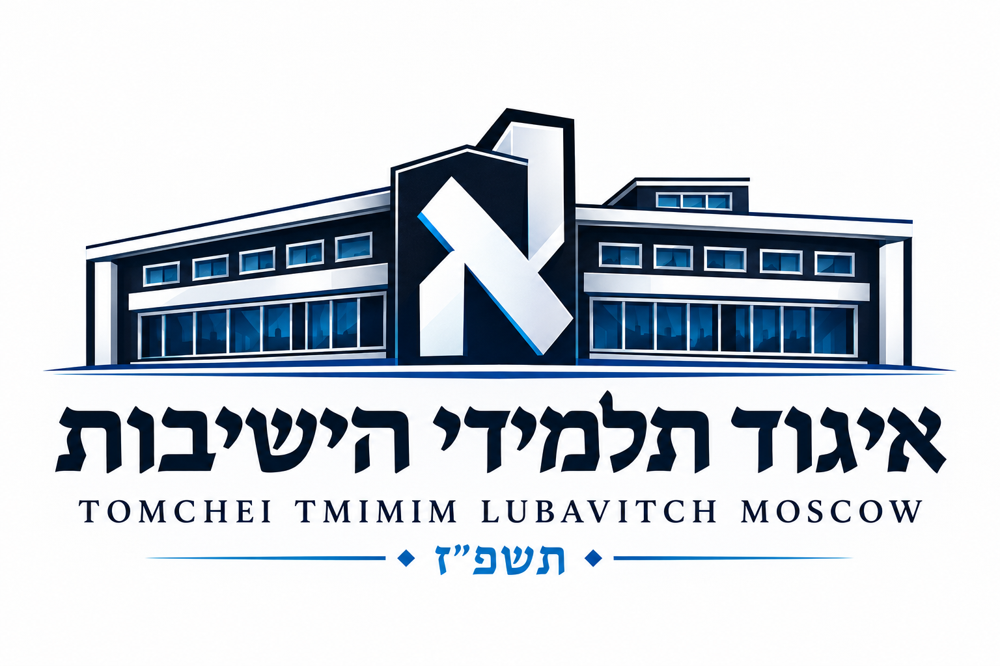

# ЕДИНЫЙ КОНТЕКСТ КОДА ПРОЕКТА АТО (תשפ״ז)
_Автоматически собрано из ветки `main`: 2026-11-23 15:13 UTC_

---

## Файл: `index.html`
```html
<!DOCTYPE html>
<html lang="ru">
<head>
  <meta charset="UTF-8" />
  <meta name="viewport" content="width=device-width, initial-scale=1.0" />
  <title>Сообщество АТО • תשפ״ז — Архив изданий, афиша и поддержка</title>
  <meta name="description" content="Игуд Талмидей а-Ешивот Москва (תשפ״ז) • Архив журналов «Кунтрес Тмимим», койвецов, афиша событий, новости ешивы и поддержка проектов сообщества." />

  <!-- Open Graph / Превью для Telegram, WhatsApp и соцсетей -->
  <meta property="og:type" content="website" />
  <meta property="og:site_name" content="Сообщество АТО • Москва (תשפ״ז)" />
  <meta property="og:locale" content="ru_RU" />
  <meta property="og:url" content="https://igud-talmidei-haeshivot-moscow.github.io/ato-site/" />
  <meta property="og:title" content="Сообщество АТО • תשפ״ז — Архив изданий, афиша и поддержка" />
  <meta property="og:description" content="Игуд Талмидей а-Ешивот Москва • Архив журналов, койвецов, афиша событий, новости ешивы и редакционные статьи." />
  <meta property="og:image" content="https://igud-talmidei-haeshivot-moscow.github.io/ato-site/logo.png" />
  <meta property="og:image:alt" content="Логотип Игуд Талмидей а-Ешивот — Сообщество АТО" />

  <!-- Twitter / Карточка превью -->
  <meta name="twitter:card" content="summary" />
  <meta name="twitter:title" content="Сообщество АТО • תשפ״ז — Архив изданий, афиша и поддержка" />
  <meta name="twitter:description" content="Игуд Талмидей а-Ешивот Москва • Архив журналов, койвецов, афиша событий и редакционные статьи." />
  <meta name="twitter:image" content="https://igud-talmidei-haeshivot-moscow.github.io/ato-site/logo.png" />

  <link rel="icon" type="image/png" href="logo.png" />
  <link rel="apple-touch-icon" href="logo.png" />
  <link rel="manifest" href="manifest.json" />
  <meta name="theme-color" content="#07162B" />
  <meta name="mobile-web-app-capable" content="yes" />
  <meta name="apple-mobile-web-app-capable" content="yes" />
  <meta name="apple-mobile-web-app-status-bar-style" content="black-translucent" />
  <meta name="apple-mobile-web-app-title" content="АТО Москва" />
  <link rel="preconnect" href="https://fonts.googleapis.com">
  <link rel="preconnect" href="https://fonts.gstatic.com" crossorigin>
  <link href="https://fonts.googleapis.com/css2?family=Inter:wght@400;500;600;700&family=Oswald:wght@500;600;700&display=swap" rel="stylesheet">
  <link rel="stylesheet" href="style.css" />

  <!-- Yandex.Metrika counter -->
  <script type="text/javascript">
      (function(m,e,t,r,i,k,a){
          m[i]=m[i]||function(){(m[i].a=m[i].a||[]).push(arguments)};
          m[i].l=1*new Date();
          for (var j = 0; j < document.scripts.length; j++) {if (document.scripts[j].src === r) { return; }}
          k=e.createElement(t),a=e.getElementsByTagName(t)[0],k.async=1,k.src=r,a.parentNode.insertBefore(k,a)
      })(window, document,'script','https://mc.yandex.ru/metrika/tag.js?id=114297805', 'ym');

      ym(114297805, 'init', {ssr:true, webvisor:true, clickmap:true, ecommerce:"dataLayer", referrer: document.referrer, url: location.href, accurateTrackBounce:true, trackLinks:true});
  </script>
  <!-- /Yandex.Metrika counter -->
</head>
<body>
 <body>
  <div id="atoPreloader" class="ato-preloader" role="status" aria-live="polite" aria-label="Загрузка архива АТО">
    <div class="ato-preloader-card">
      <div class="ato-preloader-logo">
        
      </div>
      <div class="ato-preloader-eyebrow">
        <span class="diamond"></span>
        <span>Tomchei Tmimin Lubavitch Moscow • תשפ״ז</span>
        <span class="diamond"></span>
      </div>
      <div class="ato-preloader-title">Загрузка архива...</div>
      <div class="ato-preloader-bar">
        <div class="ato-preloader-bar-fill"></div>
      </div>
    </div>
  </div>

  <noscript><div></div></noscript>

  <div class="zmanim-bar">
    <div class="container zmanim-inner">
      <div class="zmanim-city">
        <span class="live-dot"></span>
        <span>Зманим • Москва</span>
      </div>
      <div class="zmanim-times">
        <div class="zmanim-item">
          <span>Зажигание свечей:</span>
          <strong id="candleTime">загрузка...</strong>
        </div>
        <div class="zmanim-item">
          <span>Выход Шаббата:</span>
          <strong id="havdalahTime">загрузка...</strong>
        </div>
      </div>
    </div>
  </div>

  <header>
    <div class="container header-grid">
      <div class="brand-block">
        <div class="logo-frame">
          
        </div>
        <div>
          <div class="brand-eyebrow">
            <span class="diamond"></span>
            <span>Tomchei Tmimin Lubavitch Moscow • תשפ״ז</span>
            <span class="diamond"></span>
          </div>
          <h1>Сообщество АТО</h1>
         <p class="subtitle">Игуд Талмидей а-Ешивот Москва • Архив журналов, койвецов, новости ешивы и не только!</p>
        </div>
      </div>

     <div class="tg-links">
        <a href="https://t.me/Igud_Talmidei_Haeshivot_5787" target="_blank" rel="noopener" class="tg-btn primary">
          <span>Telegram-канал АТО</span>
          <span>↗</span>
        </a>
        <a href="https://t.me/ATO_Moscow" target="_blank" rel="noopener" class="tg-sub-link">
          Связаться с редакцией: @ATO_Moscow
        </a>
      </div>
  </header>

<main>
<div class="container">
<div id="featuredIssueSlot"></div>
<div id="calendarContextSlot"></div>
<div id="dailyQuoteSlot"></div>
      <div class="controls">
       <nav class="main-tabs" id="mainTabs" aria-label="Разделы сайта">
          <button type="button" class="filter-btn active" data-mode="ARTICLES">Статьи</button>
          <button type="button" class="filter-btn" data-mode="ISSUES">Выпуски (PDF)</button>
          <button type="button" class="filter-btn" data-mode="NIGUNIM">Нигуним</button>
          <button type="button" class="filter-btn" data-mode="NEWS">Афиша и новости</button>
          <button type="button" class="filter-btn" data-mode="DONATE">Пожертвования</button>
          <button type="button" class="filter-btn" data-mode="ABOUT">О сообществе</button>
        </nav>
        <input type="search" id="searchInput" class="search-input" placeholder="Поиск по названию, главе или автору...">
      </div>

      <div class="sub-filters" id="rubricSubBar"></div>

      <div id="contentArea">
        <div class="status-box">Загрузка архива...</div>
      </div>
    </div>
  </main>

  <!-- Встроенная читалка PDF -->
  <div class="pdf-modal" id="pdfModal" role="dialog" aria-modal="true" aria-labelledby="pdfModalTitle">
    <div class="pdf-dialog">
      <div class="pdf-toolbar">
        <div class="pdf-title" id="pdfModalTitle">Просмотр документа</div>
        <div class="pdf-actions">
          <button type="button" id="pdfCopyLinkBtn" class="pdf-action-btn">Скопировать ссылку</button>
          <a href="#" id="pdfDownloadLink" target="_blank" rel="noopener noreferrer" class="pdf-action-btn">Скачать / Открыть в новой вкладке ↗</a>
          <button type="button" id="pdfCloseBtn" class="pdf-close-btn">Закрыть ✕</button>
        </div>
      </div>
      <iframe id="pdfFrame" class="pdf-frame" src="" title="Встроенный просмотр PDF"></iframe>
    </div>
  </div>

 <footer>
    <div class="container footer-layout">
      <div class="footer-socials">
        <a href="https://t.me/Igud_Talmidei_Haeshivot_5787" target="_blank" rel="noopener" class="footer-social-btn" title="Официальный Telegram-канал АТО" aria-label="Telegram-канал АТО">
          <svg viewBox="0 0 24 24" width="20" height="20" fill="currentColor" aria-hidden="true"><path d="M11.944 0A12 12 0 0 0 0 12a12 12 0 0 0 12 12 12 12 0 0 0 12-12A12 12 0 0 0 12 0a12 12 0 0 0-.056 0zm4.962 7.224c.1-.002.321.023.465.14a.506.506 0 0 1 .171.325c.016.093.036.306.02.472-.18 1.898-.962 6.502-1.36 8.627-.168.9-.499 1.201-.82 1.23-.696.065-1.225-.46-1.9-.902-1.056-.693-1.653-1.124-2.678-1.8-1.185-.78-.417-1.21.258-1.91.177-.184 3.247-2.977 3.307-3.23.007-.032.014-.15-.056-.212s-.174-.041-.249-.024c-.106.024-1.793 1.14-5.061 3.345-.48.33-.913.49-1.302.48-.428-.008-1.252-.241-1.865-.44-.752-.245-1.349-.374-1.297-.789.027-.216.325-.437.893-.663 3.498-1.524 5.83-2.529 6.998-3.014 3.332-1.386 4.025-1.627 4.476-1.635z"/></svg>
          <span>Канал АТО</span>
        </a>
        <a href="https://t.me/ATO_Moscow" target="_blank" rel="noopener" class="footer-social-btn" title="Связаться с редакцией @ATO_Moscow" aria-label="Связаться с редакцией">
          <svg viewBox="0 0 24 24" width="19" height="19" fill="none" stroke="currentColor" stroke-width="2" stroke-linecap="round" stroke-linejoin="round" aria-hidden="true"><path d="M21 15a2 2 0 0 1-2 2H7l-4 4V5a2 2 0 0 1 2-2h14a2 2 0 0 1 2 2z"/></svg>
          <span>Редакция @ATO_Moscow</span>
        </a>
      </div>

      <nav class="footer-legal-links" aria-label="Правовая информация и регламент">
        <button type="button" class="footer-doc-btn" data-doc="privacy">Политика конфиденциальности</button>
        <button type="button" class="footer-doc-btn" data-doc="terms">Условия использования материалов</button>
        <button type="button" class="footer-doc-btn" data-doc="support">О поддержке проектов</button>
        <button type="button" class="footer-doc-btn" data-doc="about_org">О редакции и контакты</button>
      </nav>

      <div class="footer-caption">
        Некоммерческий образовательно-издательский проект сообщества учеников ешивы <strong>«Игуд Талмидей а-Ешивот Москва» (АТО) • תשפ״ז</strong>.
        Материалы сайта предназначены для изучения Торы и Хасидута. Контакты редакции: <a href="https://t.me/ATO_Moscow" target="_blank" rel="noopener">@ATO_Moscow</a>.
      </div>
    </div>
  </footer>

  <!-- Модальное окно правовых и редакционных документов -->
  <div class="legal-modal" id="legalModal" role="dialog" aria-modal="true" aria-labelledby="legalModalTitle">
    <div class="legal-dialog">
      <div class="legal-toolbar">
        <div class="legal-title-wrap">
          <span class="diamond"></span>
          <h2 class="legal-title" id="legalModalTitle">Документ</h2>
        </div>
        <button type="button" id="legalCloseBtn" class="pdf-close-btn" aria-label="Закрыть окно">Закрыть ✕</button>
      </div>
      <div class="legal-body" id="legalModalBody"></div>
    </div>
  </div>
<div id="nigunPlayerBar" class="nigun-player-bar" aria-label="Плеер нигуна">
    <div class="nigun-player-inner">
      <div class="nigun-player-info">
        <span id="nigunPlayerCategory" class="nigun-badge">♪ Нигун</span>
        <div class="nigun-title-wrap">
          <span id="nigunPlayerTitle" class="nigun-player-title">Название нигуна</span>
          <a id="nigunArticleLink" href="#" class="nigun-article-link" style="display:none;">Читать статью →</a>
        </div>
      </div>

      <div class="nigun-controls-center">
        <div class="nigun-transport">
          <button type="button" id="nigunShuffleBtn" class="nigun-icon-btn" title="Перемешать" aria-label="Перемешать">⇄</button>
          <button type="button" id="nigunPrevBtn" class="nigun-icon-btn" title="Предыдущий нигун" aria-label="Предыдущий">⏮</button>
          <button type="button" id="nigunPlayPauseBtn" class="nigun-play-btn" title="Пуск / Пауза" aria-label="Пуск / Пауза">▶</button>
          <button type="button" id="nigunNextBtn" class="nigun-icon-btn" title="Следующий нигун" aria-label="Следующий">⏭</button>
          <button type="button" id="nigunRepeatBtn" class="nigun-icon-btn" title="Повтор: выкл" aria-label="Повтор">↻</button>
        </div>
        <div class="nigun-timeline">
          <span id="nigunCurrentTime" class="nigun-time">0:00</span>
          <input type="range" id="nigunProgress" class="nigun-progress" min="0" max="100" step="0.1" value="0" aria-label="Перемотка" />
          <span id="nigunDurationTime" class="nigun-time">0:00</span>
        </div>
      </div>

      <div class="nigun-player-right">
        <input type="range" id="nigunVolume" class="nigun-volume" min="0" max="1" step="0.05" value="1" title="Громкость" aria-label="Громкость" />
        <a id="nigunDownloadBtn" href="#" download class="nigun-icon-btn" title="Скачать MP3" aria-label="Скачать MP3">⬇</a>
        <button type="button" id="nigunPlayerClose" class="nigun-close-btn" aria-label="Закрыть плеер" title="Закрыть">✕</button>
      </div>
    </div>
  </div>
<button type="button" id="scrollTopBtn" class="scroll-top-btn" aria-label="Наверх" title="Наверх">↑</button>
  <script src="app.js"></script>
</body>
</html>
```

## Файл: `style.css`
```css
:root {
  --bg-page: #F3F7FC;
  --bg-surface: #FFFFFF;
  --bg-tint: #E6EFFA;
  --navy-deep: #07162B;
  --navy-mid: #0F2747;
  --blue-accent: #0A74DA;
  --blue-bright: #1E88E5;
  --border-subtle: #CFE0F5;
  --text-main: #0A192F;
  --text-muted: #4A607A;
  --shadow-card: 0 10px 28px -8px rgba(7, 22, 43, 0.10), 0 2px 6px -1px rgba(7, 22, 43, 0.05);
  --shadow-hover: 0 18px 36px -10px rgba(10, 116, 218, 0.22), 0 4px 12px -2px rgba(7, 22, 43, 0.08);
}

* {
  box-sizing: border-box;
  margin: 0;
  padding: 0;
}

body {
  background-color: var(--bg-page);
  background-image:
    radial-gradient(circle at 12% 0%, rgba(10, 116, 218, 0.07) 0%, transparent 42%),
    radial-gradient(circle at 88% 12%, rgba(7, 22, 43, 0.05) 0%, transparent 45%);
  color: var(--text-main);
  font-family: 'Inter', sans-serif;
  line-height: 1.55;
  border-top: 4px solid var(--blue-accent);
  overflow-x: hidden;
}

.container {
  max-width: 1140px;
  margin: 0 auto;
}

@keyframes fadeSlideUp {
  from {
    opacity: 0;
    transform: translateY(18px);
  }
  to {
    opacity: 1;
    transform: translateY(0);
  }
}

@keyframes pulseDot {
  0%, 100% {
    transform: scale(1);
    opacity: 1;
  }
  50% {
    transform: scale(1.45);
    opacity: 0.55;
  }
}

@keyframes modalZoomIn {
  from {
    opacity: 0;
    transform: scale(0.96) translateY(10px);
  }
  to {
    opacity: 1;
    transform: scale(1) translateY(0);
  }
}

/* Верхняя плашка зманим (Москва) */
.zmanim-bar {
  background-color: var(--navy-deep);
  color: #E6EFFA;
  border-bottom: 1px solid rgba(10, 116, 218, 0.45);
  padding: 0.55rem 1.5rem;
  font-size: 0.88rem;
}

.zmanim-inner {
  display: flex;
  flex-wrap: wrap;
  justify-content: space-between;
  align-items: center;
  gap: 0.6rem 1.5rem;
}

.zmanim-city {
  display: inline-flex;
  align-items: center;
  gap: 0.55rem;
  font-family: 'Oswald', sans-serif;
  text-transform: uppercase;
  letter-spacing: 0.08em;
  color: #64B5F6;
  font-weight: 600;
  font-size: 0.85rem;
}

.live-dot {
  width: 8px;
  height: 8px;
  border-radius: 50%;
  background-color: var(--blue-bright);
  box-shadow: 0 0 8px var(--blue-bright);
  animation: pulseDot 2.4s infinite ease-in-out;
}

.zmanim-times {
  display: flex;
  flex-wrap: wrap;
  gap: 0.5rem 1.75rem;
}

.zmanim-item span {
  color: #A8C0DC;
}

.zmanim-item strong {
  font-family: 'Oswald', sans-serif;
  font-size: 1rem;
  letter-spacing: 0.04em;
  color: #FFFFFF;
  margin-left: 0.35rem;
}

/* Шапка сайта в стиле логотипа АТО 5787 */
header {
  background: linear-gradient(135deg, #FFFFFF 0%, #EDF4FC 60%, #E1ECFA 100%);
  color: var(--navy-deep);
  border-bottom: 2px solid var(--border-subtle);
  padding: 2rem 1.5rem 2.25rem;
  position: relative;
  overflow: hidden;
}

header::after {
  content: "";
  position: absolute;
  bottom: 0;
  left: 0;
  right: 0;
  height: 3px;
  background: linear-gradient(90deg, transparent 0%, var(--blue-accent) 25%, var(--navy-deep) 50%, var(--blue-accent) 75%, transparent 100%);
}

.header-grid {
  display: flex;
  flex-wrap: wrap;
  justify-content: space-between;
  align-items: center;
  gap: 1.75rem;
  animation: fadeSlideUp 0.55s ease-out both;
}

.brand-block {
  display: flex;
  flex-wrap: wrap;
  align-items: center;
  gap: 1.5rem;
}

.logo-frame {
  background-color: #FFFFFF;
  padding: 0.65rem 1rem;
  border-radius: 14px;
  border: 1.5px solid var(--border-subtle);
  box-shadow: 0 12px 30px -8px rgba(7, 22, 43, 0.14);
  display: flex;
  align-items: center;
  justify-content: center;
  transition: transform 0.35s cubic-bezier(0.22, 1, 0.36, 1), box-shadow 0.35s ease;
}

.logo-frame:hover {
  transform: translateY(-3px) scale(1.02);
  box-shadow: 0 16px 36px -8px rgba(10, 116, 218, 0.24);
}

.logo-frame img {
  height: 86px;
  width: auto;
  display: block;
}

.brand-eyebrow {
  display: inline-flex;
  align-items: center;
  gap: 0.6rem;
  font-family: 'Oswald', sans-serif;
  font-size: 0.85rem;
  font-weight: 600;
  letter-spacing: 0.12em;
  text-transform: uppercase;
  color: var(--blue-accent);
  margin-bottom: 0.25rem;
}

.diamond {
  display: inline-block;
  width: 6px;
  height: 6px;
  background-color: var(--blue-accent);
  transform: rotate(45deg);
}

h1 {
  font-family: 'Oswald', sans-serif;
  font-size: clamp(2.1rem, 4.5vw, 3.2rem);
  font-weight: 700;
  text-transform: uppercase;
  letter-spacing: 0.03em;
  line-height: 1.05;
  color: var(--navy-deep);
}

.subtitle {
  margin-top: 0.45rem;
  font-size: 0.98rem;
  color: var(--text-muted);
  max-width: 500px;
}

/* Единый блок кнопок Telegram в шапке */
.tg-links {
  display: flex;
  flex-direction: column;
  gap: 0.6rem;
  min-width: 295px;
}

.tg-btn {
  display: flex;
  align-items: center;
  justify-content: space-between;
  gap: 0.75rem;
  font-family: 'Oswald', sans-serif;
  font-weight: 600;
  font-size: 0.93rem;
  text-transform: uppercase;
  letter-spacing: 0.05em;
  text-decoration: none;
  padding: 0.72rem 1.25rem;
  border-radius: 10px;
  transition: transform 0.22s ease, box-shadow 0.22s ease, background 0.22s ease, border-color 0.22s ease;
}

.tg-btn.primary {
  background: linear-gradient(135deg, var(--navy-deep) 0%, var(--navy-mid) 100%);
  color: #FFFFFF;
  border: 1.5px solid var(--navy-deep);
  box-shadow: 0 8px 20px -6px rgba(7, 22, 43, 0.35);
}

.tg-btn.primary:hover {
  background: linear-gradient(135deg, var(--blue-accent) 0%, var(--navy-mid) 100%);
  border-color: var(--blue-accent);
  transform: translateY(-2px);
  box-shadow: 0 12px 24px -6px rgba(10, 116, 218, 0.45);
}

.tg-btn.secondary {
  background-color: #FFFFFF;
  color: var(--navy-deep);
  border: 1.5px solid var(--border-subtle);
  box-shadow: 0 4px 12px -4px rgba(7, 22, 43, 0.08);
}

.tg-btn.secondary:hover {
  background-color: var(--bg-tint);
  border-color: var(--blue-accent);
  color: var(--blue-accent);
  transform: translateY(-2px);
  box-shadow: 0 8px 18px -6px rgba(10, 116, 218, 0.22);
}

/* Навигация и фильтры */
.controls {
  margin: 2rem auto 1.4rem;
  display: flex;
  flex-wrap: wrap;
  justify-content: space-between;
  align-items: center;
  gap: 1rem;
  padding-bottom: 1.25rem;
  border-bottom: 1.5px solid var(--border-subtle);
  animation: fadeSlideUp 0.65s ease-out both;
}

.rubrics {
  display: flex;
  flex-wrap: wrap;
  align-items: center;
  gap: 0.5rem;
}

.filter-btn {
  background-color: var(--bg-surface);
  border: 1.5px solid var(--border-subtle);
  color: var(--navy-deep);
  font-family: 'Oswald', sans-serif;
  font-size: 0.92rem;
  font-weight: 500;
  text-transform: uppercase;
  letter-spacing: 0.04em;
  padding: 0.5rem 0.95rem;
  border-radius: 8px;
  cursor: pointer;
  transition: all 0.2s cubic-bezier(0.22, 1, 0.36, 1);
}

.filter-btn:hover {
  border-color: var(--blue-accent);
  color: var(--blue-accent);
  transform: translateY(-1px);
}

.filter-btn.active {
  background-color: var(--navy-deep);
  border-color: var(--navy-deep);
  color: #FFFFFF;
  box-shadow: 0 6px 14px -4px rgba(7, 22, 43, 0.3);
}

.filter-btn.issues-tab {
  background-color: var(--bg-tint);
  border-color: #B6D2F2;
  color: var(--navy-deep);
  font-weight: 600;
}

.filter-btn.news-tab {
  background-color: #EBF4FF;
  border-color: var(--blue-accent);
  color: var(--blue-accent);
  font-weight: 600;
}

.filter-btn.donate-tab {
  background: linear-gradient(135deg, var(--blue-accent) 0%, #0658A8 100%);
  border-color: var(--blue-accent);
  color: #FFFFFF;
  font-weight: 600;
}

.filter-btn.about-tab {
  background-color: var(--bg-surface);
  border-color: var(--navy-deep);
  color: var(--navy-deep);
  font-weight: 600;
}

.filter-btn.issues-tab:hover,
.filter-btn.issues-tab.active,
.filter-btn.news-tab:hover,
.filter-btn.news-tab.active,
.filter-btn.donate-tab:hover,
.filter-btn.donate-tab.active,
.filter-btn.about-tab:hover,
.filter-btn.about-tab.active {
  background: var(--navy-deep);
  border-color: var(--navy-deep);
  color: #FFFFFF;
  box-shadow: 0 6px 16px -4px rgba(10, 116, 218, 0.35);
}

.divider-v {
  width: 1.5px;
  height: 24px;
  background-color: var(--border-subtle);
  margin: 0 0.25rem;
}

.search-input {
  padding: 0.58rem 1rem;
  border: 1.5px solid var(--border-subtle);
  border-radius: 8px;
  background-color: var(--bg-surface);
  font-family: 'Inter', sans-serif;
  font-size: 0.93rem;
  min-width: 260px;
  color: var(--navy-deep);
  transition: border-color 0.2s ease, box-shadow 0.2s ease;
}

.search-input:focus {
  outline: none;
  border-color: var(--blue-accent);
  box-shadow: 0 0 0 3px rgba(10, 116, 218, 0.14);
}

/* Подфильтры для Афиши и новостей */
.sub-filters {
  display: flex;
  flex-wrap: wrap;
  gap: 0.5rem;
  margin-bottom: 1.5rem;
  animation: fadeSlideUp 0.35s ease-out both;
}

.sub-btn {
  background-color: var(--bg-surface);
  border: 1.5px solid var(--border-subtle);
  color: var(--text-muted);
  font-family: 'Oswald', sans-serif;
  font-size: 0.85rem;
  text-transform: uppercase;
  letter-spacing: 0.04em;
  padding: 0.38rem 0.85rem;
  border-radius: 999px;
  cursor: pointer;
  transition: all 0.2s ease;
}

.sub-btn:hover {
  border-color: var(--blue-accent);
  color: var(--blue-accent);
}

.sub-btn.active {
  background-color: var(--blue-accent);
  border-color: var(--blue-accent);
  color: #FFFFFF;
  box-shadow: 0 4px 12px -2px rgba(10, 116, 218, 0.35);
}

main {
  padding: 0 1.5rem 4rem;
}

/* Сетка карточек с каскадной анимацией */
.grid {
  display: grid;
  grid-template-columns: repeat(auto-fill, minmax(315px, 1fr));
  gap: 1.5rem;
}

.card {
  background-color: var(--bg-surface);
  border: 1.5px solid var(--border-subtle);
  border-radius: 14px;
  box-shadow: var(--shadow-card);
  display: flex;
  flex-direction: column;
  justify-content: space-between;
  overflow: hidden;
  opacity: 0;
  animation: fadeSlideUp 0.48s cubic-bezier(0.22, 1, 0.36, 1) forwards;
  transition: transform 0.28s cubic-bezier(0.22, 1, 0.36, 1), box-shadow 0.28s ease, border-color 0.28s ease;
}

.card:hover {
  transform: translateY(-5px);
  border-color: var(--blue-accent);
  box-shadow: var(--shadow-hover);
}

.card-top {
  background: linear-gradient(90deg, var(--navy-deep) 0%, var(--navy-mid) 100%);
  color: #E6EFFA;
  padding: 0.55rem 1.15rem;
  font-family: 'Oswald', sans-serif;
  font-size: 0.83rem;
  text-transform: uppercase;
  letter-spacing: 0.06em;
  display: flex;
  justify-content: space-between;
  align-items: center;
}

.card.issue-card .card-top,
.card.news-afisha .card-top {
  background: linear-gradient(90deg, var(--blue-accent) 0%, #0658A8 100%);
  color: #FFFFFF;
}

.card.news-spoiler .card-top {
  background: linear-gradient(90deg, #163B6B 0%, var(--blue-accent) 100%);
  color: #FFFFFF;
}

.card.issue-card {
  border-color: #A8C8EE;
}

.card-photo-wrap {
  overflow: hidden;
  border-bottom: 1.5px solid var(--border-subtle);
  background-color: var(--bg-tint);
}

.card-photo {
  width: 100%;
  max-height: 245px;
  object-fit: cover;
  display: block;
  transition: transform 0.45s cubic-bezier(0.22, 1, 0.36, 1);
}

.card:hover .card-photo {
  transform: scale(1.03);
}

.card-body {
  padding: 1.3rem 1.35rem;
  flex-grow: 1;
}

.card-title {
  font-family: 'Oswald', sans-serif;
  font-size: 1.42rem;
  line-height: 1.22;
  color: var(--navy-deep);
  margin-bottom: 0.65rem;
  text-transform: uppercase;
}

.card-desc {
  font-size: 0.94rem;
  color: var(--text-muted);
  margin-bottom: 0.5rem;
  white-space: pre-line;
}

.card-footer {
  padding: 0 1.35rem 1.35rem;
}

.read-btn {
  display: block;
  width: 100%;
  text-align: center;
  background-color: var(--bg-tint);
  color: var(--navy-deep);
  border: 1.5px solid #B6D2F2;
  border-radius: 9px;
  font-family: 'Oswald', sans-serif;
  font-weight: 600;
  font-size: 0.93rem;
  text-transform: uppercase;
  letter-spacing: 0.05em;
  text-decoration: none;
  padding: 0.68rem 1rem;
  cursor: pointer;
  transition: all 0.22s ease;
}

.read-btn:hover {
  background-color: var(--blue-accent);
  border-color: var(--blue-accent);
  color: #FFFFFF;
  box-shadow: 0 6px 14px -3px rgba(10, 116, 218, 0.35);
}

/* Встроенная читалка PDF (модальное окно) */
.pdf-modal {
  position: fixed;
  inset: 0;
  background-color: rgba(7, 22, 43, 0.78);
  backdrop-filter: blur(5px);
  display: none;
  align-items: center;
  justify-content: center;
  padding: 1rem;
  z-index: 1000;
}

.pdf-modal.open {
  display: flex;
}

.pdf-dialog {
  background-color: var(--bg-surface);
  border: 2px solid var(--blue-accent);
  border-radius: 14px;
  box-shadow: 0 24px 60px rgba(7, 22, 43, 0.45);
  width: 100%;
  max-width: 1020px;
  height: 88vh;
  display: flex;
  flex-direction: column;
  overflow: hidden;
  animation: modalZoomIn 0.28s cubic-bezier(0.22, 1, 0.36, 1) both;
}

.pdf-toolbar {
  background: linear-gradient(90deg, var(--navy-deep) 0%, var(--navy-mid) 100%);
  color: #FFFFFF;
  padding: 0.8rem 1.25rem;
  border-bottom: 2px solid var(--blue-accent);
  display: flex;
  justify-content: space-between;
  align-items: center;
  gap: 1rem;
}

.pdf-title {
  font-family: 'Oswald', sans-serif;
  font-size: 1.15rem;
  text-transform: uppercase;
  letter-spacing: 0.03em;
  white-space: nowrap;
  overflow: hidden;
  text-overflow: ellipsis;
}

.pdf-actions {
  display: flex;
  align-items: center;
  gap: 0.6rem;
  flex-shrink: 0;
}

.pdf-action-btn {
  background-color: var(--blue-accent);
  color: #FFFFFF;
  border: 1px solid rgba(255, 255, 255, 0.25);
  border-radius: 7px;
  font-family: 'Oswald', sans-serif;
  font-weight: 600;
  font-size: 0.85rem;
  text-transform: uppercase;
  letter-spacing: 0.04em;
  text-decoration: none;
  padding: 0.42rem 0.9rem;
  cursor: pointer;
  transition: background-color 0.2s ease;
}

.pdf-action-btn:hover {
  background-color: var(--blue-bright);
}

.pdf-close-btn {
  background-color: rgba(255, 255, 255, 0.12);
  color: #FFFFFF;
  border: 1px solid rgba(255, 255, 255, 0.25);
  border-radius: 7px;
  font-family: 'Oswald', sans-serif;
  font-weight: 600;
  font-size: 0.85rem;
  text-transform: uppercase;
  padding: 0.42rem 0.9rem;
  cursor: pointer;
  transition: background-color 0.2s ease;
}

.pdf-close-btn:hover {
  background-color: #D32F2F;
  border-color: #D32F2F;
}

.pdf-frame {
  width: 100%;
  height: 100%;
  border: none;
  background-color: #1A2433;
}

/* Раздел пожертвований и Топ-10 меценатов */
.donate-layout {
  display: grid;
  grid-template-columns: 1fr;
  gap: 2rem;
  animation: fadeSlideUp 0.45s ease-out both;
}

@media (min-width: 860px) {
  .donate-layout {
    grid-template-columns: 1fr 1.35fr;
    align-items: start;
  }
}

.donate-box {
  background: linear-gradient(155deg, var(--navy-deep) 0%, var(--navy-mid) 100%);
  color: #FFFFFF;
  border: 1.5px solid rgba(10, 116, 218, 0.35);
  border-radius: 16px;
  box-shadow: 0 16px 36px -10px rgba(7, 22, 43, 0.28);
  padding: 1.85rem;
}

.donate-box h2 {
  font-family: 'Oswald', sans-serif;
  font-size: 1.85rem;
  text-transform: uppercase;
  line-height: 1.15;
  margin-bottom: 0.9rem;
  color: #FFFFFF;
}

.donate-box p {
  color: #C4D7EE;
  font-size: 0.96rem;
  margin-bottom: 1.15rem;
}

.donate-list {
  list-style: none;
  margin-bottom: 1.6rem;
  border-top: 1px solid rgba(255, 255, 255, 0.15);
  padding-top: 1rem;
}

.donate-list li {
  position: relative;
  padding-left: 1.35rem;
  margin-bottom: 0.55rem;
  font-size: 0.93rem;
  color: #E6EFFA;
}

.donate-list li::before {
  content: "◆";
  position: absolute;
  left: 0;
  font-size: 0.75rem;
  top: 0.15rem;
  color: #64B5F6;
}

.donate-cta {
  display: block;
  text-align: center;
  background: linear-gradient(135deg, var(--blue-accent) 0%, var(--blue-bright) 100%);
  color: #FFFFFF;
  border-radius: 10px;
  font-family: 'Oswald', sans-serif;
  font-weight: 600;
  font-size: 1.08rem;
  text-transform: uppercase;
  letter-spacing: 0.06em;
  text-decoration: none;
  padding: 0.92rem 1.25rem;
  box-shadow: 0 8px 20px -4px rgba(10, 116, 218, 0.45);
  transition: transform 0.2s ease, box-shadow 0.2s ease;
}

.donate-cta:hover {
  transform: translateY(-2px);
  box-shadow: 0 12px 26px -4px rgba(30, 136, 229, 0.6);
}

.patrons-box {
  background-color: var(--bg-surface);
  border: 1.5px solid var(--border-subtle);
  border-radius: 16px;
  box-shadow: var(--shadow-card);
  overflow: hidden;
}

.patrons-header {
  background: linear-gradient(90deg, var(--navy-deep) 0%, var(--navy-mid) 100%);
  color: #FFFFFF;
  padding: 1.05rem 1.5rem;
  border-bottom: 3px solid var(--blue-accent);
  display: flex;
  justify-content: space-between;
  align-items: center;
  flex-wrap: wrap;
  gap: 0.5rem;
}

.patrons-header h2 {
  font-family: 'Oswald', sans-serif;
  font-size: 1.48rem;
  text-transform: uppercase;
  letter-spacing: 0.04em;
}

.patrons-header span {
  font-family: 'Oswald', sans-serif;
  color: #90CAF9;
  font-size: 0.88rem;
  text-transform: uppercase;
  letter-spacing: 0.06em;
}

.patron-row {
  display: grid;
  grid-template-columns: 48px 1fr auto;
  align-items: center;
  gap: 1rem;
  padding: 0.95rem 1.35rem;
  border-bottom: 1px solid var(--bg-tint);
  transition: background-color 0.2s ease;
}

.patron-row:hover {
  background-color: #F7FAFF;
}

.patron-row:last-child {
  border-bottom: none;
}

.patron-rank {
  font-family: 'Oswald', sans-serif;
  font-weight: 700;
  font-size: 1.1rem;
  text-align: center;
  padding: 0.35rem 0;
  border-radius: 8px;
  border: 1.5px solid var(--border-subtle);
  background-color: var(--bg-tint);
  color: var(--navy-deep);
}

.patron-row.top-3 .patron-rank {
  background-color: var(--blue-accent);
  border-color: var(--blue-accent);
  color: #FFFFFF;
}

.patron-row:first-child .patron-rank {
  background-color: var(--navy-deep);
  border-color: var(--navy-deep);
  color: #FFFFFF;
  box-shadow: 0 4px 10px rgba(7, 22, 43, 0.25);
}

.patron-name {
  font-family: 'Oswald', sans-serif;
  font-size: 1.18rem;
  text-transform: uppercase;
  color: var(--navy-deep);
  line-height: 1.2;
}

.patron-dedication {
  font-size: 0.88rem;
  color: var(--text-muted);
  margin-top: 0.2rem;
}

.patron-tier {
  font-family: 'Oswald', sans-serif;
  font-size: 0.83rem;
  text-transform: uppercase;
  letter-spacing: 0.05em;
  background-color: var(--bg-tint);
  border: 1px solid #B6D2F2;
  color: var(--navy-deep);
  padding: 0.28rem 0.65rem;
  border-radius: 6px;
  white-space: nowrap;
}

/* Раздел «О сообществе» */
.about-layout {
  display: flex;
  flex-direction: column;
  gap: 1.75rem;
  animation: fadeSlideUp 0.45s ease-out both;
}

.about-hero {
  background: linear-gradient(145deg, var(--navy-deep) 0%, var(--navy-mid) 100%);
  color: #FFFFFF;
  border: 1.5px solid rgba(10, 116, 218, 0.35);
  border-radius: 16px;
  box-shadow: 0 16px 36px -10px rgba(7, 22, 43, 0.26);
  padding: 2.1rem 2.25rem;
  position: relative;
  overflow: hidden;
}

.about-hero::after {
  content: "א";
  position: absolute;
  right: 2rem;
  bottom: -1.4rem;
  font-family: 'Oswald', sans-serif;
  font-size: 11rem;
  font-weight: 700;
  line-height: 1;
  color: rgba(10, 116, 218, 0.14);
  pointer-events: none;
}

.about-hero h2 {
  font-family: 'Oswald', sans-serif;
  font-size: clamp(1.65rem, 3vw, 2.25rem);
  text-transform: uppercase;
  letter-spacing: 0.03em;
  line-height: 1.15;
  margin-bottom: 1rem;
  color: #FFFFFF;
  position: relative;
  z-index: 1;
}

.about-hero p {
  font-size: 1.03rem;
  line-height: 1.65;
  color: #D3E3F7;
  max-width: 820px;
  position: relative;
  z-index: 1;
}

.about-grid {
  display: grid;
  grid-template-columns: 1fr;
  gap: 1.5rem;
}

@media (min-width: 760px) {
  .about-grid {
    grid-template-columns: repeat(2, 1fr);
  }
}

.about-card {
  background-color: var(--bg-surface);
  border: 1.5px solid var(--border-subtle);
  border-radius: 14px;
  box-shadow: var(--shadow-card);
  padding: 1.65rem 1.75rem;
  transition: transform 0.25s ease, border-color 0.25s ease, box-shadow 0.25s ease;
}

.about-card:hover {
  transform: translateY(-4px);
  border-color: var(--blue-accent);
  box-shadow: var(--shadow-hover);
}

.about-card-tag {
  display: inline-flex;
  align-items: center;
  gap: 0.45rem;
  font-family: 'Oswald', sans-serif;
  font-size: 0.82rem;
  font-weight: 600;
  text-transform: uppercase;
  letter-spacing: 0.08em;
  color: var(--blue-accent);
  margin-bottom: 0.55rem;
}

.about-card h3 {
  font-family: 'Oswald', sans-serif;
  font-size: 1.45rem;
  text-transform: uppercase;
  color: var(--navy-deep);
  margin-bottom: 0.65rem;
}

.about-card p {
  font-size: 0.96rem;
  color: var(--text-muted);
  line-height: 1.6;
}

.about-contact-bar {
  background-color: var(--bg-surface);
  border: 1.5px solid var(--border-subtle);
  border-radius: 14px;
  box-shadow: var(--shadow-card);
  padding: 1.4rem 1.75rem;
  display: flex;
  flex-wrap: wrap;
  justify-content: space-between;
  align-items: center;
  gap: 1.25rem;
}

.about-contact-text {
  font-size: 0.96rem;
  color: var(--text-main);
  max-width: 680px;
}

.about-contact-text a {
  color: var(--blue-accent);
  font-weight: 600;
  text-decoration: none;
}

.about-contact-text a:hover {
  text-decoration: underline;
}

.about-contact-btn {
  display: inline-flex;
  align-items: center;
  gap: 0.55rem;
  background: linear-gradient(135deg, var(--blue-accent) 0%, var(--navy-mid) 100%);
  color: #FFFFFF;
  font-family: 'Oswald', sans-serif;
  font-weight: 600;
  font-size: 0.95rem;
  text-transform: uppercase;
  letter-spacing: 0.05em;
  text-decoration: none;
  padding: 0.8rem 1.35rem;
  border-radius: 10px;
  box-shadow: 0 8px 20px -6px rgba(10, 116, 218, 0.4);
  transition: transform 0.2s ease, box-shadow 0.2s ease;
}

.about-contact-btn:hover {
  transform: translateY(-2px);
  box-shadow: 0 12px 24px -6px rgba(10, 116, 218, 0.55);
}

.status-box {
  text-align: center;
  padding: 3rem 1rem;
  background-color: var(--bg-surface);
  border: 1.5px dashed #9EC2EC;
  border-radius: 14px;
  font-family: 'Oswald', sans-serif;
  font-size: 1.15rem;
  text-transform: uppercase;
  letter-spacing: 0.04em;
  color: var(--text-muted);
  animation: fadeSlideUp 0.35s ease-out both;
}

footer {
  background-color: var(--navy-deep);
  color: #C4D7EE;
  border-top: 3px solid var(--blue-accent);
  padding: 1.85rem 1.5rem;
  font-size: 0.9rem;
}

.footer-inner {
  display: flex;
  flex-wrap: wrap;
  justify-content: space-between;
  gap: 1rem;
}

footer a {
  color: #64B5F6;
  text-decoration: none;
  transition: color 0.2s ease;
}

footer a:hover {
  color: #FFFFFF;
}
/* Кнопка «Наверх» */
.scroll-top-btn {
  position: fixed;
  right: 1.5rem;
  bottom: 1.5rem;
  width: 46px;
  height: 46px;
  border-radius: 12px;
  border: 1.5px solid rgba(10, 116, 218, 0.45);
  background: linear-gradient(135deg, var(--navy-deep) 0%, var(--navy-mid) 100%);
  color: #FFFFFF;
  font-family: 'Oswald', sans-serif;
  font-size: 1.25rem;
  font-weight: 700;
  cursor: pointer;
  box-shadow: 0 10px 24px -6px rgba(7, 22, 43, 0.45);
  opacity: 0;
  visibility: hidden;
  transform: translateY(12px);
  transition: opacity 0.25s ease, transform 0.25s ease, visibility 0.25s ease, background 0.2s ease;
  z-index: 900;
}

.scroll-top-btn.visible {
  opacity: 1;
  visibility: visible;
  transform: translateY(0);
}

.scroll-top-btn:hover {
  background: linear-gradient(135deg, var(--blue-accent) 0%, var(--navy-mid) 100%);
  transform: translateY(-3px);
}
/* Пасхалка 18 кликов по логотипу */
.logo-frame {
  cursor: pointer;
  user-select: none;
}

.easter-overlay {
  position: fixed;
  inset: 0;
  background: radial-gradient(circle at center, rgba(15, 39, 71, 0.92) 0%, rgba(7, 22, 43, 0.97) 100%);
  backdrop-filter: blur(8px);
  display: flex;
  align-items: center;
  justify-content: center;
  padding: 1.5rem;
  z-index: 2000;
  opacity: 0;
  visibility: hidden;
  transition: opacity 0.45s ease, visibility 0.45s ease;
}

.easter-overlay.active {
  opacity: 1;
  visibility: visible;
}

.easter-card {
  max-width: 820px;
  width: 100%;
  text-align: center;
  padding: 2.75rem 2rem;
  border-radius: 20px;
  border: 2px solid rgba(100, 181, 246, 0.55);
  background: linear-gradient(160deg, rgba(15, 39, 71, 0.85) 0%, rgba(7, 22, 43, 0.95) 100%);
  box-shadow: 0 0 60px rgba(10, 116, 218, 0.45), 0 24px 60px rgba(0, 0, 0, 0.6);
  transform: scale(0.86) translateY(20px);
  transition: transform 0.55s cubic-bezier(0.22, 1, 0.36, 1);
}

.easter-overlay.active .easter-card {
  transform: scale(1) translateY(0);
}

.easter-diamonds {
  display: inline-flex;
  align-items: center;
  gap: 0.75rem;
  color: #64B5F6;
  font-family: 'Oswald', sans-serif;
  letter-spacing: 0.16em;
  font-size: 0.9rem;
  margin-bottom: 1.1rem;
}

.easter-text {
  direction: rtl;
  font-size: clamp(1.85rem, 4.6vw, 3.2rem);
  font-weight: 700;
  line-height: 1.35;
  color: #FFFFFF;
  text-shadow: 0 0 26px rgba(100, 181, 246, 0.75), 0 2px 10px rgba(0, 0, 0, 0.5);
  margin-bottom: 1.75rem;
}

.easter-close {
  background: linear-gradient(135deg, var(--blue-accent) 0%, var(--blue-bright) 100%);
  color: #FFFFFF;
  border: 1px solid rgba(255, 255, 255, 0.3);
  border-radius: 10px;
  font-family: 'Oswald', sans-serif;
  font-size: 0.95rem;
  font-weight: 600;
  text-transform: uppercase;
  letter-spacing: 0.06em;
  padding: 0.65rem 1.6rem;
  cursor: pointer;
  transition: transform 0.2s ease, box-shadow 0.2s ease;
}

.easter-close:hover {
  transform: translateY(-2px);
  box-shadow: 0 10px 24px rgba(30, 136, 229, 0.55);
}
/* Блок «Быть Томимом каждый день» */
.daily-quote-box {
  margin: 1.75rem auto 0;
  background: linear-gradient(135deg, #FFFFFF 0%, #EEF5FD 100%);
  border: 1.5px solid #B6D2F2;
  border-left: 5px solid var(--blue-accent);
  border-radius: 14px;
  box-shadow: var(--shadow-card);
  padding: 1.35rem 1.65rem;
  display: flex;
  flex-direction: column;
  gap: 0.85rem;
  animation: fadeSlideUp 0.55s ease-out both;
}

.daily-quote-top {
  display: flex;
  flex-wrap: wrap;
  justify-content: space-between;
  align-items: center;
  gap: 0.5rem;
}

.daily-quote-label {
  display: inline-flex;
  align-items: center;
  gap: 0.55rem;
  font-family: 'Oswald', sans-serif;
  font-size: 0.88rem;
  font-weight: 600;
  text-transform: uppercase;
  letter-spacing: 0.08em;
  color: var(--blue-accent);
}

.daily-quote-text {
  font-size: 1.05rem;
  font-style: italic;
  line-height: 1.6;
  color: var(--navy-deep);
}

.daily-quote-bottom {
  display: flex;
  flex-wrap: wrap;
  justify-content: space-between;
  align-items: center;
  gap: 0.85rem;
  padding-top: 0.65rem;
  border-top: 1px solid var(--border-subtle);
}

.daily-quote-source {
  font-family: 'Oswald', sans-serif;
  font-size: 0.92rem;
  text-transform: uppercase;
  letter-spacing: 0.03em;
  color: var(--text-muted);
}

.daily-quote-actions {
  display: flex;
  flex-wrap: wrap;
  gap: 0.5rem;
}

.quote-btn {
  background-color: var(--bg-surface);
  border: 1.5px solid var(--border-subtle);
  color: var(--navy-deep);
  font-family: 'Oswald', sans-serif;
  font-size: 0.85rem;
  font-weight: 600;
  text-transform: uppercase;
  letter-spacing: 0.04em;
  padding: 0.42rem 0.85rem;
  border-radius: 8px;
  cursor: pointer;
  transition: all 0.2s ease;
}

.quote-btn:hover {
  border-color: var(--blue-accent);
  color: var(--blue-accent);
  transform: translateY(-1px);
}

.quote-btn.primary {
  background-color: var(--blue-accent);
  border-color: var(--blue-accent);
  color: #FFFFFF;
}

.quote-btn.primary:hover {
  background-color: var(--navy-deep);
  border-color: var(--navy-deep);
  color: #FFFFFF;
}

@media (max-width: 768px) {
  .daily-quote-box {
    margin-top: 1.25rem;
    padding: 1.15rem 1.2rem;
  }

  .daily-quote-actions {
    width: 100%;
  }

  .quote-btn {
    flex: 1 1 auto;
    text-align: center;
  }
}
/* Облегчённая шапка, цитата дня и двухэтажная навигация */
header {
  padding: 1.45rem 1.5rem 1.65rem;
}

.logo-frame {
  padding: 0.5rem 0.85rem;
}

.logo-frame img {
  height: 74px;
}

.tg-links {
  min-width: auto;
  align-items: flex-end;
  gap: 0.45rem;
}

.tg-btn {
  padding: 0.62rem 1.15rem;
  font-size: 0.9rem;
}

.tg-sub-link {
  font-size: 0.84rem;
  color: var(--text-muted);
  text-decoration: none;
  transition: color 0.2s ease;
}

.tg-sub-link:hover {
  color: var(--blue-accent);
  text-decoration: underline;
}

.daily-quote-box {
  margin: 1.25rem auto 0;
  background: var(--bg-surface);
  border: 1.5px solid var(--border-subtle);
  box-shadow: 0 4px 16px -6px rgba(7, 22, 43, 0.08);
  padding: 1rem 1.35rem;
  gap: 0.6rem;
}

.daily-quote-text {
  font-size: 0.98rem;
  line-height: 1.52;
}

.daily-quote-bottom {
  padding-top: 0.5rem;
}

.controls {
  margin: 1.25rem auto 1rem;
  padding-bottom: 0.95rem;
  gap: 0.75rem;
}

.main-tabs {
  display: flex;
  flex-wrap: wrap;
  align-items: center;
  gap: 0.45rem;
}

.main-tabs .filter-btn {
  background-color: var(--bg-surface);
  border: 1.5px solid var(--border-subtle);
  color: var(--navy-deep);
  font-weight: 500;
  padding: 0.46rem 0.9rem;
  font-size: 0.9rem;
}

.main-tabs .filter-btn:hover {
  border-color: var(--blue-accent);
  color: var(--blue-accent);
}

.main-tabs .filter-btn.active {
  background-color: var(--navy-deep);
  border-color: var(--navy-deep);
  color: #FFFFFF;
}

.sub-filters:empty {
  display: none;
}

@media (max-width: 768px) {
  .tg-links {
    align-items: stretch;
    text-align: center;
  }
}
/* Встроенный плеер нигунов */
.card-footer-actions {
  display: flex;
  flex-wrap: wrap;
  align-items: center;
  justify-content: space-between;
  gap: 0.6rem;
  width: 100%;
}

.listen-btn {
  display: inline-flex;
  align-items: center;
  gap: 0.4rem;
  background-color: #EEF5FD;
  border: 1.5px solid #B6D2F2;
  color: var(--blue-accent);
  font-family: 'Oswald', sans-serif;
  font-size: 0.85rem;
  font-weight: 600;
  text-transform: uppercase;
  letter-spacing: 0.04em;
  padding: 0.35rem 0.75rem;
  border-radius: 8px;
  cursor: pointer;
  transition: all 0.2s ease;
}

.listen-btn:hover {
  background-color: var(--blue-accent);
  border-color: var(--blue-accent);
  color: #FFFFFF;
}

.nigun-player-bar {
  position: fixed;
  left: 0;
  right: 0;
  bottom: 0;
  background: linear-gradient(135deg, var(--navy-deep) 0%, var(--navy-mid) 100%);
  border-top: 2px solid var(--blue-accent);
  box-shadow: 0 -10px 30px rgba(7, 22, 43, 0.45);
  color: #FFFFFF;
  z-index: 950;
  transform: translateY(105%);
  transition: transform 0.3s cubic-bezier(0.22, 1, 0.36, 1);
  padding: 0.75rem 1.25rem;
}

.nigun-player-bar.open {
  transform: translateY(0);
}

.nigun-player-inner {
  max-width: 1200px;
  margin: 0 auto;
  display: flex;
  flex-wrap: wrap;
  align-items: center;
  justify-content: space-between;
  gap: 0.85rem;
}

.nigun-player-info {
  display: flex;
  align-items: center;
  gap: 0.65rem;
  min-width: 180px;
  flex: 1 1 220px;
}

.nigun-badge {
  background-color: var(--blue-accent);
  color: #FFFFFF;
  font-family: 'Oswald', sans-serif;
  font-size: 0.78rem;
  font-weight: 600;
  text-transform: uppercase;
  letter-spacing: 0.05em;
  padding: 0.2rem 0.55rem;
  border-radius: 6px;
  white-space: nowrap;
}

.nigun-player-title {
  font-family: 'Oswald', sans-serif;
  font-size: 1rem;
  letter-spacing: 0.02em;
  color: #FFFFFF;
  white-space: nowrap;
  overflow: hidden;
  text-overflow: ellipsis;
}

.nigun-player-media {
  flex: 2 1 320px;
  display: flex;
  align-items: center;
}

.nigun-player-media audio {
  width: 100%;
  height: 36px;
  border-radius: 8px;
}

.nigun-player-media iframe {
  width: 100%;
  height: 54px;
  border: none;
  border-radius: 8px;
}

.nigun-close-btn {
  background: rgba(255, 255, 255, 0.12);
  border: 1px solid rgba(255, 255, 255, 0.25);
  color: #FFFFFF;
  width: 34px;
  height: 34px;
  border-radius: 8px;
  cursor: pointer;
  font-size: 1rem;
  display: inline-flex;
  align-items: center;
  justify-content: center;
  transition: background 0.2s ease;
}

.nigun-close-btn:hover {
  background: rgba(255, 255, 255, 0.24);
}
@media (prefers-reduced-motion: reduce) {
  *, *::before, *::after {
    animation-duration: 0.01ms !important;
    transition-duration: 0.01ms !important;
  }
  /* Мобильная адаптация шапки и навигации */
@media (max-width: 768px) {
  .zmanim-bar {
    padding: 0.5rem 1rem;
  }

  .zmanim-inner {
    justify-content: center;
    text-align: center;
    gap: 0.35rem 1rem;
  }

  header {
    padding: 1.5rem 1rem 1.75rem;
  }

  .header-grid {
    flex-direction: column;
    align-items: stretch;
    gap: 1.25rem;
  }

  .brand-block {
    flex-direction: column;
    align-items: center;
    text-align: center;
    gap: 0.9rem;
  }

  .logo-frame img {
    height: 74px;
  }

  .brand-eyebrow {
    justify-content: center;
    font-size: 0.78rem;
  }

  .subtitle {
    font-size: 0.92rem;
    margin-left: auto;
    margin-right: auto;
  }

  .tg-links {
    width: 100%;
    min-width: 0;
  }

  .tg-btn {
    width: 100%;
    padding: 0.8rem 1rem;
    font-size: 0.88rem;
  }

  main {
    padding: 0 1rem 3rem;
  }

  .controls {
    flex-direction: column;
    align-items: stretch;
    margin: 1.4rem auto 1.1rem;
  }

  .search-input {
    width: 100%;
    min-width: 0;
  }

  .divider-v {
    display: none;
  }

  .pdf-toolbar {
    flex-wrap: wrap;
    padding: 0.7rem 0.9rem;
  }

  .pdf-title {
    width: 100%;
    font-size: 1rem;
  }

  .pdf-actions {
    width: 100%;
    justify-content: space-between;
  }

  .pdf-action-btn,
  .pdf-close-btn {
    padding: 0.4rem 0.65rem;
    font-size: 0.78rem;
  }
}
}
/* Раздел «Нигуним» и расширенный плеер */
body.player-open .scroll-top-btn {
  bottom: 5.5rem;
}

body.player-open footer {
  padding-bottom: 6.25rem;
}

.nigun-list-toolbar {
  display: flex;
  flex-wrap: wrap;
  justify-content: space-between;
  align-items: center;
  gap: 0.75rem;
  margin-bottom: 1rem;
  padding: 0.75rem 1.1rem;
  background-color: var(--bg-surface);
  border: 1.5px solid var(--border-subtle);
  border-radius: 12px;
}

.nigun-count-info {
  font-family: 'Oswald', sans-serif;
  font-size: 0.92rem;
  text-transform: uppercase;
  letter-spacing: 0.04em;
  color: var(--text-muted);
}

.nigun-list {
  display: flex;
  flex-direction: column;
  gap: 0.55rem;
  animation: fadeSlideUp 0.4s ease-out both;
}

.nigun-row {
  display: grid;
  grid-template-columns: 38px 34px 1fr auto;
  align-items: center;
  gap: 0.75rem;
  background-color: var(--bg-surface);
  border: 1.5px solid var(--border-subtle);
  border-radius: 11px;
  padding: 0.65rem 1rem;
  box-shadow: 0 3px 10px -4px rgba(7, 22, 43, 0.06);
  transition: border-color 0.2s ease, transform 0.2s ease, background-color 0.2s ease;
}

.nigun-row:hover {
  border-color: var(--blue-accent);
  background-color: #F7FAFF;
}

.nigun-row.active-track {
  border-color: var(--blue-accent);
  background: linear-gradient(90deg, #EBF4FF 0%, #FFFFFF 100%);
}

.nigun-row-play {
  width: 38px;
  height: 38px;
  border-radius: 9px;
  border: 1.5px solid #B6D2F2;
  background-color: var(--bg-tint);
  color: var(--navy-deep);
  font-size: 0.9rem;
  font-weight: 700;
  cursor: pointer;
  display: inline-flex;
  align-items: center;
  justify-content: center;
  transition: all 0.2s ease;
}

.nigun-row:hover .nigun-row-play,
.nigun-row.active-track .nigun-row-play {
  background-color: var(--blue-accent);
  border-color: var(--blue-accent);
  color: #FFFFFF;
}

.nigun-row-num {
  font-family: 'Oswald', sans-serif;
  font-size: 0.92rem;
  font-weight: 600;
  color: var(--text-muted);
  text-align: center;
}

.nigun-row-info {
  cursor: pointer;
  min-width: 0;
}

.nigun-row-title {
  font-family: 'Oswald', sans-serif;
  font-size: 1.08rem;
  letter-spacing: 0.02em;
  color: var(--navy-deep);
  white-space: nowrap;
  overflow: hidden;
  text-overflow: ellipsis;
}

.nigun-row.active-track .nigun-row-title {
  color: var(--blue-accent);
}

.nigun-row-actions {
  display: flex;
  align-items: center;
  gap: 0.5rem;
}

.nigun-row-tag {
  font-family: 'Oswald', sans-serif;
  font-size: 0.78rem;
  text-transform: uppercase;
  letter-spacing: 0.05em;
  background-color: var(--bg-tint);
  border: 1px solid #B6D2F2;
  color: var(--navy-deep);
  padding: 0.22rem 0.55rem;
  border-radius: 6px;
  white-space: nowrap;
}

.nigun-row-article {
  background-color: var(--navy-deep);
  color: #FFFFFF;
  border: none;
  border-radius: 6px;
  font-family: 'Oswald', sans-serif;
  font-size: 0.78rem;
  text-transform: uppercase;
  letter-spacing: 0.04em;
  padding: 0.26rem 0.6rem;
  cursor: pointer;
  transition: background-color 0.2s ease;
}

.nigun-row-article:hover {
  background-color: var(--blue-accent);
}

.nigun-row-dl {
  width: 30px;
  height: 30px;
  border-radius: 7px;
  border: 1px solid var(--border-subtle);
  background-color: var(--bg-page);
  color: var(--navy-deep);
  text-decoration: none;
  font-size: 0.85rem;
  display: inline-flex;
  align-items: center;
  justify-content: center;
  transition: all 0.2s ease;
}

.nigun-row-dl:hover {
  border-color: var(--blue-accent);
  background-color: var(--blue-accent);
  color: #FFFFFF;
}
.nigun-row-share {
  height: 30px;
  padding: 0 0.65rem;
  border-radius: 7px;
  border: 1px solid var(--border-subtle);
  background-color: var(--bg-page);
  color: var(--navy-deep);
  font-family: 'Oswald', sans-serif;
  font-size: 0.78rem;
  font-weight: 500;
  text-transform: uppercase;
  letter-spacing: 0.04em;
  cursor: pointer;
  white-space: nowrap;
  transition: all 0.2s ease;
}

.nigun-row-share:hover {
  border-color: var(--blue-accent);
  background-color: #EEF5FD;
  color: var(--blue-accent);
}

.nigun-row-share.copied {
  background-color: #E8F7EE;
  border-color: #2E9E63;
  color: #166534;
}

@media (max-width: 540px) {
  .nigun-row-tag {
    display: none;
  }
}
/* Улучшенный нижний плеер */
.nigun-title-wrap {
  display: flex;
  flex-direction: column;
  min-width: 0;
}

.nigun-article-link {
  font-size: 0.78rem;
  color: #90CAF9;
  text-decoration: none;
}

.nigun-article-link:hover {
  text-decoration: underline;
  color: #FFFFFF;
}

.nigun-controls-center {
  flex: 2 1 360px;
  display: flex;
  flex-direction: column;
  gap: 0.35rem;
}

.nigun-transport {
  display: flex;
  align-items: center;
  justify-content: center;
  gap: 0.5rem;
}

.nigun-play-btn {
  width: 36px;
  height: 36px;
  border-radius: 50%;
  border: none;
  background-color: var(--blue-accent);
  color: #FFFFFF;
  font-size: 0.92rem;
  font-weight: 700;
  cursor: pointer;
  display: inline-flex;
  align-items: center;
  justify-content: center;
  box-shadow: 0 4px 12px rgba(10, 116, 218, 0.45);
  transition: transform 0.18s ease, background-color 0.18s ease;
}

.nigun-play-btn:hover {
  background-color: var(--blue-bright);
  transform: scale(1.06);
}

.nigun-icon-btn {
  background: rgba(255, 255, 255, 0.1);
  border: 1px solid rgba(255, 255, 255, 0.2);
  color: #E6EFFA;
  height: 32px;
  min-width: 32px;
  padding: 0 0.45rem;
  border-radius: 8px;
  font-size: 0.88rem;
  text-decoration: none;
  cursor: pointer;
  display: inline-flex;
  align-items: center;
  justify-content: center;
  transition: background-color 0.2s ease, border-color 0.2s ease, color 0.2s ease;
}

.nigun-icon-btn:hover {
  background: rgba(255, 255, 255, 0.22);
  color: #FFFFFF;
}

.nigun-icon-btn.active {
  background-color: var(--blue-accent);
  border-color: var(--blue-bright);
  color: #FFFFFF;
}

.nigun-timeline {
  display: flex;
  align-items: center;
  gap: 0.55rem;
}

.nigun-time {
  font-family: 'Oswald', sans-serif;
  font-size: 0.78rem;
  color: #A8C0DC;
  min-width: 34px;
  text-align: center;
}

.nigun-progress {
  flex: 1;
  accent-color: var(--blue-bright);
  cursor: pointer;
  height: 5px;
}

.nigun-player-right {
  display: flex;
  align-items: center;
  gap: 0.5rem;
}

.nigun-volume {
  width: 74px;
  accent-color: var(--blue-bright);
  cursor: pointer;
}

@media (max-width: 768px) {
  .main-tabs {
    gap: 0.35rem;
  }

  .main-tabs .filter-btn {
    padding: 0.42rem 0.72rem;
    font-size: 0.84rem;
  }

  .nigun-row {
    grid-template-columns: 36px 1fr auto;
    gap: 0.55rem;
    padding: 0.6rem 0.75rem;
  }

  .nigun-row-num {
    display: none;
  }

  .nigun-volume {
    display: none;
  }

  .nigun-player-bar {
    padding: 0.6rem 0.85rem calc(0.6rem + env(safe-area-inset-bottom, 0px));
  }

  .nigun-player-inner {
    gap: 0.45rem 0.6rem;
  }

  .nigun-player-info {
    flex: 1 1 calc(100% - 96px);
    min-width: 0;
  }

  .nigun-player-right {
    margin-left: auto;
  }

  .nigun-controls-center {
    flex: 1 1 100%;
    order: 3;
  }

  body.player-open .scroll-top-btn {
    bottom: calc(8.75rem + env(safe-area-inset-bottom, 0px));
    right: 1rem;
  }

  body.player-open footer {
    padding-bottom: calc(9.25rem + env(safe-area-inset-bottom, 0px));
  }
}

@media (max-width: 480px) {
  .nigun-row {
    grid-template-columns: 36px 1fr;
    row-gap: 0.5rem;
  }

  .nigun-row-title {
    white-space: normal;
    line-height: 1.25;
  }

  .nigun-row-actions {
    grid-column: 2;
    flex-wrap: wrap;
    gap: 0.4rem;
  }

  .nigun-row-tag {
    display: none;
  }

  .nigun-transport {
    gap: 0.4rem;
  }

  body.player-open .scroll-top-btn {
    bottom: calc(9.5rem + env(safe-area-inset-bottom, 0px));
  }
}
/* Витрина «Свежий выпуск номера» */
.featured-issue-banner {
  margin: 1.35rem auto 0;
  background: linear-gradient(135deg, var(--navy-deep) 0%, var(--navy-mid) 62%, #133A6B 100%);
  color: #FFFFFF;
  border: 1.5px solid rgba(30, 136, 229, 0.45);
  border-radius: 16px;
  box-shadow: 0 16px 36px -12px rgba(7, 22, 43, 0.35);
  padding: 1.4rem 1.75rem;
  display: flex;
  flex-wrap: wrap;
  align-items: center;
  justify-content: space-between;
  gap: 1.25rem 2rem;
  position: relative;
  overflow: hidden;
  animation: fadeSlideUp 0.5s ease-out both;
}

.featured-issue-banner::after {
  content: "תשפ״ז";
  position: absolute;
  right: 1.5rem;
  bottom: -0.9rem;
  font-family: 'Oswald', sans-serif;
  font-size: 5.5rem;
  font-weight: 700;
  line-height: 1;
  color: rgba(100, 181, 246, 0.08);
  pointer-events: none;
}

.featured-issue-content {
  flex: 1 1 420px;
  min-width: 0;
  position: relative;
  z-index: 1;
}

.featured-issue-eyebrow {
  display: flex;
  flex-wrap: wrap;
  align-items: center;
  gap: 0.6rem;
  margin-bottom: 0.45rem;
}

.featured-pill {
  background: linear-gradient(135deg, var(--blue-accent) 0%, var(--blue-bright) 100%);
  color: #FFFFFF;
  font-family: 'Oswald', sans-serif;
  font-size: 0.78rem;
  font-weight: 600;
  text-transform: uppercase;
  letter-spacing: 0.07em;
  padding: 0.2rem 0.62rem;
  border-radius: 6px;
  box-shadow: 0 4px 12px rgba(10, 116, 218, 0.4);
}

.featured-meta {
  font-family: 'Oswald', sans-serif;
  font-size: 0.85rem;
  text-transform: uppercase;
  letter-spacing: 0.06em;
  color: #90CAF9;
}

.featured-issue-title {
  font-family: 'Oswald', sans-serif;
  font-size: clamp(1.45rem, 2.8vw, 1.95rem);
  font-weight: 700;
  text-transform: uppercase;
  letter-spacing: 0.02em;
  line-height: 1.15;
  color: #FFFFFF;
  margin-bottom: 0.4rem;
}

.featured-issue-desc {
  font-size: 0.93rem;
  line-height: 1.52;
  color: #C8DCF2;
  max-width: 680px;
}

.featured-issue-actions {
  display: flex;
  flex-wrap: wrap;
  align-items: center;
  gap: 0.6rem;
  position: relative;
  z-index: 1;
}

.featured-btn {
  font-family: 'Oswald', sans-serif;
  font-size: 0.9rem;
  font-weight: 600;
  text-transform: uppercase;
  letter-spacing: 0.05em;
  padding: 0.65rem 1.15rem;
  border-radius: 9px;
  cursor: pointer;
  transition: transform 0.2s ease, box-shadow 0.2s ease, background-color 0.2s ease, border-color 0.2s ease;
}

.featured-btn.primary {
  background: linear-gradient(135deg, var(--blue-accent) 0%, var(--blue-bright) 100%);
  border: 1.5px solid rgba(255, 255, 255, 0.25);
  color: #FFFFFF;
  box-shadow: 0 8px 20px -4px rgba(10, 116, 218, 0.55);
}

.featured-btn.primary:hover {
  transform: translateY(-2px);
  box-shadow: 0 12px 24px -4px rgba(30, 136, 229, 0.65);
}

.featured-btn.secondary {
  background-color: rgba(255, 255, 255, 0.1);
  border: 1.5px solid rgba(255, 255, 255, 0.26);
  color: #FFFFFF;
}

.featured-btn.secondary:hover {
  background-color: rgba(255, 255, 255, 0.2);
  border-color: #90CAF9;
}

.featured-btn.secondary.copied {
  background-color: #1B7F4B;
  border-color: #4ADE80;
  color: #FFFFFF;
}

.featured-btn.ghost {
  background-color: transparent;
  border: 1.5px solid rgba(144, 202, 249, 0.35);
  color: #90CAF9;
}

.featured-btn.ghost:hover {
  border-color: #FFFFFF;
  color: #FFFFFF;
}

/* Обновлённый футер карточек и быстрый шаринг */
.card-top-badge {
  font-weight: 600;
}

.card-top-meta {
  opacity: 0.88;
  font-size: 0.8rem;
}

.card-footer-actions {
  display: flex;
  flex-direction: column;
  gap: 0.55rem;
  width: 100%;
}

.card-primary-row {
  display: flex;
  align-items: stretch;
  gap: 0.5rem;
  width: 100%;
}

.card-primary-row .read-btn {
  flex: 1 1 auto;
}

.card-share-btn {
  flex: 0 0 auto;
  background-color: var(--bg-surface);
  color: var(--text-muted);
  border: 1.5px solid var(--border-subtle);
  border-radius: 9px;
  font-family: 'Oswald', sans-serif;
  font-size: 0.84rem;
  font-weight: 600;
  text-transform: uppercase;
  letter-spacing: 0.04em;
  padding: 0.65rem 0.85rem;
  cursor: pointer;
  white-space: nowrap;
  transition: all 0.2s ease;
}

.card-share-btn:hover {
  border-color: var(--blue-accent);
  color: var(--blue-accent);
  background-color: #F4F9FF;
}

.card-share-btn.copied {
  background-color: #E8F7EE;
  border-color: #2E9E63;
  color: #166534;
}

.card .listen-btn {
  width: 100%;
  justify-content: center;
  padding: 0.52rem 0.85rem;
}

@media (max-width: 768px) {
  .featured-issue-banner {
    padding: 1.15rem 1.2rem;
    gap: 1rem;
  }
  .featured-issue-actions {
    width: 100%;
  }
  .featured-btn.primary {
    flex: 1 1 100%;
    text-align: center;
  }
  .featured-btn.secondary,
  .featured-btn.ghost {
    flex: 1 1 calc(50% - 0.3rem);
    text-align: center;
  }
}
/* Подсветка цитаты при переходе по прямой ссылке #quote-{id} */
.daily-quote-box.quote-highlighted {
  border-color: var(--blue-accent);
  background: linear-gradient(135deg, #EBF4FF 0%, #FFFFFF 100%);
  box-shadow: 0 0 0 4px rgba(10, 116, 218, 0.18), 0 12px 28px -8px rgba(10, 116, 218, 0.25);
  transition: all 0.35s ease;
}
/* Профиль автора и кликабельный тег в карточке */
.author-link-btn {
  background: none;
  border: none;
  padding: 0;
  font: inherit;
  color: var(--blue-accent);
  font-weight: 600;
  cursor: pointer;
  text-decoration: none;
  border-bottom: 1px dashed rgba(10, 116, 218, 0.45);
  transition: color 0.2s ease, border-color 0.2s ease;
}

.author-link-btn:hover {
  color: var(--navy-deep);
  border-bottom-color: var(--navy-deep);
}

.author-profile-bar {
  display: flex;
  flex-wrap: wrap;
  justify-content: space-between;
  align-items: center;
  gap: 0.85rem;
  margin-bottom: 1.35rem;
  padding: 1rem 1.35rem;
  background: linear-gradient(135deg, #FFFFFF 0%, #EEF5FD 100%);
  border: 1.5px solid #B6D2F2;
  border-left: 5px solid var(--navy-deep);
  border-radius: 13px;
  box-shadow: 0 6px 20px -8px rgba(7, 22, 43, 0.12);
  animation: fadeSlideUp 0.35s ease-out both;
}

.author-profile-info {
  display: flex;
  flex-direction: column;
  gap: 0.2rem;
}

.author-profile-eyebrow {
  display: inline-flex;
  align-items: center;
  gap: 0.45rem;
  font-family: 'Oswald', sans-serif;
  font-size: 0.8rem;
  font-weight: 600;
  text-transform: uppercase;
  letter-spacing: 0.08em;
  color: var(--blue-accent);
}

.author-profile-name {
  font-family: 'Oswald', sans-serif;
  font-size: 1.45rem;
  font-weight: 700;
  text-transform: uppercase;
  letter-spacing: 0.02em;
  color: var(--navy-deep);
  line-height: 1.15;
}

.author-profile-stats {
  font-size: 0.9rem;
  color: var(--text-muted);
}

.author-profile-actions {
  display: flex;
  flex-wrap: wrap;
  gap: 0.5rem;
}

@media (max-width: 640px) {
  .author-profile-bar {
    padding: 0.9rem 1rem;
  }

  .author-profile-actions {
    width: 100%;
  }

  .author-profile-actions .quote-btn {
    flex: 1 1 auto;
    text-align: center;
  }
}
.author-top-btn {
  background: rgba(255, 255, 255, 0.1);
  border: 1px solid rgba(100, 181, 246, 0.45);
  border-radius: 6px;
  padding: 0.12rem 0.5rem;
  font: inherit;
  color: #E6EFFA;
  cursor: pointer;
  transition: background-color 0.2s ease, border-color 0.2s ease, color 0.2s ease;
}

.author-top-btn:hover {
  background: var(--blue-accent);
  border-color: #90CAF9;
  color: #FFFFFF;
}
/* Виджет «К дате и неделе» */
.calendar-context-box {
  margin: 1.25rem auto 0;
  background: linear-gradient(135deg, #FFFFFF 0%, #F0F6FE 100%);
  border: 1.5px solid #B6D2F2;
  border-left: 5px solid var(--blue-accent);
  border-radius: 14px;
  box-shadow: 0 6px 20px -8px rgba(7, 22, 43, 0.12);
  padding: 1.05rem 1.4rem;
  display: flex;
  flex-direction: column;
  gap: 0.75rem;
  animation: fadeSlideUp 0.5s ease-out both;
}

.calendar-context-header {
  display: flex;
  flex-wrap: wrap;
  justify-content: space-between;
  align-items: center;
  gap: 0.5rem;
}

.calendar-context-eyebrow {
  display: inline-flex;
  align-items: center;
  gap: 0.5rem;
  font-family: 'Oswald', sans-serif;
  font-size: 0.85rem;
  font-weight: 600;
  text-transform: uppercase;
  letter-spacing: 0.08em;
  color: var(--blue-accent);
}

.calendar-context-badge {
  font-family: 'Oswald', sans-serif;
  font-size: 0.8rem;
  font-weight: 600;
  text-transform: uppercase;
  letter-spacing: 0.04em;
  background-color: var(--navy-deep);
  color: #FFFFFF;
  padding: 0.2rem 0.65rem;
  border-radius: 999px;
}

.calendar-context-items {
  display: flex;
  flex-wrap: wrap;
  gap: 0.65rem;
}

.calendar-context-chip {
  flex: 1 1 260px;
  display: flex;
  align-items: center;
  justify-content: space-between;
  gap: 0.75rem;
  background-color: var(--bg-surface);
  border: 1.5px solid var(--border-subtle);
  border-radius: 10px;
  padding: 0.65rem 0.95rem;
  cursor: pointer;
  text-align: left;
  transition: border-color 0.2s ease, transform 0.2s ease, box-shadow 0.2s ease;
}

.calendar-context-chip:hover {
  border-color: var(--blue-accent);
  transform: translateY(-2px);
  box-shadow: 0 6px 16px -6px rgba(10, 116, 218, 0.28);
}

.calendar-chip-meta {
  font-family: 'Oswald', sans-serif;
  font-size: 0.75rem;
  text-transform: uppercase;
  letter-spacing: 0.05em;
  color: var(--blue-accent);
}

.calendar-chip-title {
  font-family: 'Oswald', sans-serif;
  font-size: 1.02rem;
  font-weight: 600;
  text-transform: uppercase;
  color: var(--navy-deep);
  line-height: 1.2;
}

.calendar-chip-arrow {
  font-family: 'Oswald', sans-serif;
  font-weight: 700;
  color: var(--blue-accent);
  font-size: 1.05rem;
  flex-shrink: 0;
}

@media (max-width: 768px) {
  .calendar-context-box {
    padding: 0.95rem 1.05rem;
  }

  .calendar-context-chip {
    flex: 1 1 100%;
  }
}
/* Фирменный экран загрузки АТО (Preloader) */
.ato-preloader {
  position: fixed;
  inset: 0;
  z-index: 2000;
  background-color: var(--bg-page);
  background-image:
    radial-gradient(circle at 20% 15%, rgba(10, 116, 218, 0.10) 0%, transparent 48%),
    radial-gradient(circle at 82% 85%, rgba(7, 22, 43, 0.08) 0%, transparent 50%);
  border-top: 4px solid var(--blue-accent);
  display: flex;
  align-items: center;
  justify-content: center;
  padding: 1.5rem;
  opacity: 1;
  visibility: visible;
  transition: opacity 0.42s ease, visibility 0.42s ease;
}

.ato-preloader.hidden {
  opacity: 0;
  visibility: hidden;
  pointer-events: none;
}

.ato-preloader-card {
  display: flex;
  flex-direction: column;
  align-items: center;
  text-align: center;
  max-width: 420px;
  width: 100%;
}

.ato-preloader-logo {
  background-color: #FFFFFF;
  padding: 0.85rem 1.25rem;
  border-radius: 18px;
  border: 1.5px solid var(--border-subtle);
  box-shadow: 0 16px 38px -10px rgba(7, 22, 43, 0.16);
  margin-bottom: 1.25rem;
  animation: atoLogoPulse 2s ease-in-out infinite;
}

.ato-preloader-logo img {
  height: 92px;
  width: auto;
  display: block;
}

.ato-preloader-eyebrow {
  display: inline-flex;
  align-items: center;
  justify-content: center;
  gap: 0.55rem;
  font-family: 'Oswald', sans-serif;
  font-size: 0.82rem;
  font-weight: 600;
  letter-spacing: 0.11em;
  text-transform: uppercase;
  color: var(--blue-accent);
  margin-bottom: 0.35rem;
}

.ato-preloader-title {
  font-family: 'Oswald', sans-serif;
  font-size: 1.75rem;
  font-weight: 700;
  text-transform: uppercase;
  letter-spacing: 0.05em;
  color: var(--navy-deep);
  margin-bottom: 1rem;
}

.ato-preloader-bar {
  width: 210px;
  height: 4px;
  background-color: var(--border-subtle);
  border-radius: 999px;
  overflow: hidden;
}

.ato-preloader-bar-fill {
  width: 42%;
  height: 100%;
  background: linear-gradient(90deg, var(--navy-deep) 0%, var(--blue-accent) 100%);
  border-radius: 999px;
  animation: atoBarSlide 1.15s ease-in-out infinite;
}

@keyframes atoLogoPulse {
  0%, 100% {
    transform: translateY(0) scale(1);
    box-shadow: 0 16px 38px -10px rgba(7, 22, 43, 0.16);
  }
  50% {
    transform: translateY(-4px) scale(1.02);
    box-shadow: 0 20px 42px -10px rgba(10, 116, 218, 0.24);
  }
}

@keyframes atoBarSlide {
  0% {
    transform: translateX(-110%);
  }
  100% {
    transform: translateX(260%);
  }
}
/* Расширенный футер и модальное окно правовых документов */
.footer-layout {
  display: flex;
  flex-direction: column;
  align-items: center;
  text-align: center;
  gap: 1.15rem;
  padding: 0.4rem 0;
}

.footer-socials {
  display: flex;
  flex-wrap: wrap;
  justify-content: center;
  gap: 0.75rem;
}

.footer-social-btn {
  display: inline-flex;
  align-items: center;
  gap: 0.5rem;
  padding: 0.48rem 1rem;
  border-radius: 999px;
  background-color: rgba(255, 255, 255, 0.08);
  border: 1px solid rgba(100, 181, 246, 0.35);
  color: #FFFFFF;
  text-decoration: none;
  font-family: 'Oswald', sans-serif;
  font-size: 0.85rem;
  font-weight: 500;
  text-transform: uppercase;
  letter-spacing: 0.05em;
  transition: background-color 0.2s ease, border-color 0.2s ease, transform 0.2s ease;
}

.footer-social-btn:hover {
  background-color: var(--blue-accent);
  border-color: #90CAF9;
  transform: translateY(-2px);
}

.footer-legal-links {
  display: flex;
  flex-wrap: wrap;
  justify-content: center;
  gap: 0.5rem 1.5rem;
}

.footer-doc-btn {
  background: none;
  border: none;
  padding: 0.2rem 0;
  font-family: 'Oswald', sans-serif;
  font-size: 0.86rem;
  font-weight: 500;
  text-transform: uppercase;
  letter-spacing: 0.06em;
  color: #E6EFFA;
  cursor: pointer;
  border-bottom: 1px solid transparent;
  transition: color 0.2s ease, border-color 0.2s ease;
}

.footer-doc-btn:hover {
  color: #64B5F6;
  border-bottom-color: #64B5F6;
}

.footer-caption {
  max-width: 780px;
  font-size: 0.82rem;
  line-height: 1.55;
  color: rgba(230, 239, 250, 0.75);
}

.footer-caption strong {
  color: #FFFFFF;
  font-weight: 600;
}

.footer-caption a {
  color: #90CAF9;
  text-decoration: underline;
}

/* Модалка документов */
.legal-modal {
  position: fixed;
  inset: 0;
  z-index: 1200;
  background-color: rgba(7, 22, 43, 0.78);
  backdrop-filter: blur(4px);
  display: flex;
  align-items: center;
  justify-content: center;
  padding: 1.25rem;
  opacity: 0;
  visibility: hidden;
  transition: opacity 0.25s ease, visibility 0.25s ease;
}

.legal-modal.open {
  opacity: 1;
  visibility: visible;
}

.legal-dialog {
  width: 100%;
  max-width: 760px;
  max-height: 86vh;
  background-color: var(--bg-surface);
  border: 1.5px solid var(--border-subtle);
  border-top: 4px solid var(--blue-accent);
  border-radius: 16px;
  box-shadow: 0 24px 60px rgba(7, 22, 43, 0.45);
  display: flex;
  flex-direction: column;
  overflow: hidden;
}

.legal-toolbar {
  display: flex;
  align-items: center;
  justify-content: space-between;
  gap: 1rem;
  padding: 1rem 1.35rem;
  background: linear-gradient(135deg, var(--navy-deep) 0%, var(--navy-mid) 100%);
  color: #FFFFFF;
}

.legal-title-wrap {
  display: flex;
  align-items: center;
  gap: 0.65rem;
}

.legal-title {
  font-family: 'Oswald', sans-serif;
  font-size: 1.2rem;
  font-weight: 600;
  text-transform: uppercase;
  letter-spacing: 0.04em;
  color: #FFFFFF;
  margin: 0;
}

.legal-body {
  padding: 1.45rem 1.6rem;
  overflow-y: auto;
  font-size: 0.94rem;
  line-height: 1.65;
  color: var(--navy-deep);
}

.legal-body h3 {
  font-family: 'Oswald', sans-serif;
  font-size: 1.05rem;
  text-transform: uppercase;
  letter-spacing: 0.03em;
  color: var(--blue-accent);
  margin: 1.15rem 0 0.4rem;
}

.legal-body h3:first-child {
  margin-top: 0;
}

.legal-body p {
  margin-bottom: 0.75rem;
}

.legal-body ul {
  margin: 0.4rem 0 0.9rem 1.25rem;
}

.legal-body li {
  margin-bottom: 0.35rem;
}

@media (max-width: 640px) {
  .footer-legal-links {
    flex-direction: column;
    gap: 0.45rem;
  }

  .legal-body {
    padding: 1.15rem 1.15rem;
    font-size: 0.9rem;
  }
}
/* Виджет «Актуально к дате и неделе» */
.calendar-context-box {
  margin: 1.15rem auto 0;
  background: var(--bg-surface);
  border: 1.5px solid #B6D2F2;
  border-radius: 14px;
  box-shadow: var(--shadow-card);
  padding: 1.05rem 1.35rem 1.2rem;
  animation: fadeSlideUp 0.45s ease-out both;
}

.calendar-context-header {
  display: flex;
  flex-wrap: wrap;
  align-items: center;
  justify-content: space-between;
  gap: 0.5rem 1rem;
  margin-bottom: 0.85rem;
  padding-bottom: 0.6rem;
  border-bottom: 1px solid var(--border-subtle);
}

.calendar-context-title {
  display: flex;
  align-items: center;
  gap: 0.55rem;
  font-family: 'Oswald', sans-serif;
  font-size: 1.05rem;
  font-weight: 700;
  text-transform: uppercase;
  letter-spacing: 0.04em;
  color: var(--navy-deep);
}

.calendar-context-meta {
  font-family: 'Oswald', sans-serif;
  font-size: 0.84rem;
  text-transform: uppercase;
  letter-spacing: 0.05em;
  color: var(--blue-accent);
  background-color: var(--bg-tint);
  border: 1px solid #B6D2F2;
  padding: 0.2rem 0.65rem;
  border-radius: 6px;
}

.calendar-context-grid {
  display: grid;
  grid-template-columns: repeat(auto-fit, minmax(250px, 1fr));
  gap: 0.85rem;
}

.calendar-item-card {
  background-color: #F7FAFF;
  border: 1.5px solid var(--border-subtle);
  border-radius: 10px;
  padding: 0.85rem 1rem;
  display: flex;
  flex-direction: column;
  justify-content: space-between;
  gap: 0.65rem;
  transition: transform 0.2s ease, border-color 0.2s ease, box-shadow 0.2s ease;
}

.calendar-item-card:hover {
  transform: translateY(-2px);
  border-color: var(--blue-accent);
  box-shadow: 0 8px 18px -6px rgba(10, 116, 218, 0.22);
}

.calendar-item-badge {
  display: inline-block;
  align-self: flex-start;
  font-family: 'Oswald', sans-serif;
  font-size: 0.75rem;
  font-weight: 600;
  text-transform: uppercase;
  letter-spacing: 0.05em;
  color: #FFFFFF;
  background: linear-gradient(90deg, var(--navy-deep) 0%, var(--blue-accent) 100%);
  padding: 0.16rem 0.52rem;
  border-radius: 5px;
  margin-bottom: 0.35rem;
}

.calendar-item-title {
  font-family: 'Oswald', sans-serif;
  font-size: 1.12rem;
  font-weight: 600;
  text-transform: uppercase;
  line-height: 1.22;
  color: var(--navy-deep);
}

.calendar-item-sub {
  font-size: 0.83rem;
  color: var(--text-muted);
  margin-top: 0.2rem;
}

.calendar-item-btn {
  align-self: flex-start;
  background-color: var(--bg-surface);
  border: 1.5px solid #B6D2F2;
  color: var(--navy-deep);
  font-family: 'Oswald', sans-serif;
  font-size: 0.82rem;
  font-weight: 600;
  text-transform: uppercase;
  letter-spacing: 0.04em;
  padding: 0.38rem 0.78rem;
  border-radius: 7px;
  cursor: pointer;
  transition: all 0.2s ease;
}

.calendar-item-btn:hover {
  background-color: var(--blue-accent);
  border-color: var(--blue-accent);
  color: #FFFFFF;
}
```

## Файл: `app.js`
```javascript
// ================= ЗАФИКСИРОВАННЫЕ ССЫЛКИ =================
const ARTICLES_CSV_URL = "https://docs.google.com/spreadsheets/d/e/2PACX-1vTAAuPFgjW2LESsVaPw7HYqytvR-3uGhouUlH-0jDbw6sz_UMrWhK2vWi5tBBh4Re17DeG-6mzIcQmT/pub?gid=0&single=true&output=csv";
const ISSUES_CSV_URL = "https://docs.google.com/spreadsheets/d/e/2PACX-1vTAAuPFgjW2LESsVaPw7HYqytvR-3uGhouUlH-0jDbw6sz_UMrWhK2vWi5tBBh4Re17DeG-6mzIcQmT/pub?gid=103090562&single=true&output=csv";
const NIGUNIM_CSV_URL = "https://docs.google.com/spreadsheets/d/e/2PACX-1vTAAuPFgjW2LESsVaPw7HYqytvR-3uGhouUlH-0jDbw6sz_UMrWhK2vWi5tBBh4Re17DeG-6mzIcQmT/pub?gid=1555876785&single=true&output=csv";
const PATRONS_CSV_URL = "https://docs.google.com/spreadsheets/d/e/2PACX-1vTAAuPFgjW2LESsVaPw7HYqytvR-3uGhouUlH-0jDbw6sz_UMrWhK2vWi5tBBh4Re17DeG-6mzIcQmT/pub?gid=654627083&single=true&output=csv";
const NEWS_CSV_URL = "https://docs.google.com/spreadsheets/d/e/2PACX-1vTAAuPFgjW2LESsVaPw7HYqytvR-3uGhouUlH-0jDbw6sz_UMrWhK2vWi5tBBh4Re17DeG-6mzIcQmT/pub?gid=948146673&single=true&output=csv";
const QUOTES_CSV_URL = "https://docs.google.com/spreadsheets/d/e/2PACX-1vTAAuPFgjW2LESsVaPw7HYqytvR-3uGhouUlH-0jDbw6sz_UMrWhK2vWi5tBBh4Re17DeG-6mzIcQmT/pub?gid=1487106234&single=true&output=csv";
const DONATION_URL = "https://t.me/ATO_Moscow";
// ===========================================================

let allArticles = [];
let allIssues = [];
let allNigunim = [];
let allPatrons = [];
let allNews = [];
let allQuotes = [];
let currentQuoteIndex = 0;
let currentMode = "ARTICLES";
let currentRubric = "ALL";
let currentAuthor = "ALL";
let currentNigunCategory = "ALL";
let currentNewsCategory = "ALL";

function sanitizeUrl(url) {
  const clean = (url || "").trim();
  if (/^audio\/[a-zA-Z0-9._-]+$/i.test(clean)) return clean;
  return /^https?:\/\//i.test(clean) ? clean : "";
}

function getEmbedPdfUrl(url) {
  const safe = sanitizeUrl(url);
  if (!safe) return "";
  const driveMatch = safe.match(/drive\.google\.com\/file\/d\/([a-zA-Z0-9_-]+)/);
  if (driveMatch) {
    return `https://drive.google.com/file/d/${driveMatch[1]}/preview`;
  }
  return safe;
}

function openPdfReader(title, rawUrl, hashSlug) {
  const safeUrl = sanitizeUrl(rawUrl);
  if (!safeUrl) return;

  if (hashSlug) {
    history.replaceState(null, "", `#${hashSlug}`);
  }

  if (typeof ym === "function") {
    ym(114297805, "reachGoal", "open_pdf", { doc_title: title || "Документ" });
  }

  const modal = document.getElementById("pdfModal");
  const titleEl = document.getElementById("pdfModalTitle");
  const frameEl = document.getElementById("pdfFrame");
  const downloadEl = document.getElementById("pdfDownloadLink");
  const copyBtn = document.getElementById("pdfCopyLinkBtn");

  titleEl.textContent = title || "Просмотр документа";
  downloadEl.href = safeUrl;
  frameEl.src = getEmbedPdfUrl(safeUrl);
  if (copyBtn) copyBtn.textContent = "Скопировать ссылку";

  modal.classList.add("open");
  document.body.style.overflow = "hidden";
}

function closePdfReader() {
  const modal = document.getElementById("pdfModal");
  const frameEl = document.getElementById("pdfFrame");
  modal.classList.remove("open");
  frameEl.src = "";
  document.body.style.overflow = "";

  if (window.location.hash && /^#(issue|article)-/i.test(window.location.hash)) {
    history.replaceState(null, "", window.location.pathname + window.location.search);
  }
}

function handleHashNavigation() {
  const hash = window.location.hash.replace(/^#/, "").trim();
  if (!hash) return;

  const issueMatch = hash.match(/^issue-(\d+)$/i);
  if (issueMatch) {
    const idx = parseInt(issueMatch[1], 10) - 1;
    const item = allIssues[idx];
    if (item && sanitizeUrl(item.link)) {
      currentMode = "ISSUES";
      const issuesBtn = document.querySelector('#mainTabs [data-mode="ISSUES"]');
      setActiveButton(issuesBtn);
      renderRubricSubBar(allArticles);
      renderContent();
      openPdfReader(item.title, item.link, `issue-${idx + 1}`);
    }
    return;
  }

  const articleMatch = hash.match(/^article-(\d+)$/i);
  if (articleMatch) {
    const idx = parseInt(articleMatch[1], 10) - 1;
    const item = allArticles[idx];
    if (item && sanitizeUrl(item.link)) {
      currentMode = "ARTICLES";
      currentRubric = "ALL";
      const articlesBtn = document.querySelector('#mainTabs [data-mode="ARTICLES"]');
      setActiveButton(articlesBtn);
      renderRubricSubBar(allArticles);
      renderContent();
      openPdfReader(item.title, item.link, `article-${idx + 1}`);
    }
    return;
  }

  const nigunMatch = hash.match(/^nigun-(\d+)$/i);
  if (nigunMatch) {
    const idx = parseInt(nigunMatch[1], 10) - 1;
    const item = allNigunim[idx];
    if (item && sanitizeUrl(item.audio)) {
      currentMode = "NIGUNIM";
      currentNigunCategory = "ALL";
      const nigunBtn = document.querySelector('#mainTabs [data-mode="NIGUNIM"]');
      setActiveButton(nigunBtn);
      renderRubricSubBar(allArticles);
      renderContent();
      playNigunFromList(item, allNigunim);
    }
    return;
  }

  const quoteMatch = hash.match(/^quote-(\d+)$/i);
  if (quoteMatch) {
    const idx = parseInt(quoteMatch[1], 10) - 1;
    if (allQuotes[idx]) {
      currentQuoteIndex = idx;
      renderDailyQuote(false);
      const slot = document.getElementById("dailyQuoteSlot");
      if (slot) {
        slot.scrollIntoView({ behavior: "smooth", block: "center" });
        slot.classList.add("quote-highlight");
        setTimeout(() => slot.classList.remove("quote-highlight"), 2200);
      }
    }
    return;
  }

  const authorMatch = hash.match(/^author-(.+)$/i);
  if (authorMatch) {
    const requestedSlug = decodeURIComponent(authorMatch[1]).toLowerCase();
    const matched = allArticles.find(a => a.author && toAuthorSlug(a.author).toLowerCase() === requestedSlug);
    if (matched) {
      filterByAuthor(matched.author, false);
    }
  }
}

function toAuthorSlug(authorName) {
  return (authorName || "")
    .trim()
    .replace(/\s+/g, "-");
}

function filterByAuthor(authorName, shouldScroll = true) {
  currentMode = "ARTICLES";
  currentRubric = "ALL";
  currentAuthor = authorName || "ALL";

  const articlesBtn = document.querySelector('#mainTabs [data-mode="ARTICLES"]');
  setActiveButton(articlesBtn);
  renderRubricSubBar(allArticles);
  renderContent();

  if (currentAuthor !== "ALL") {
    history.replaceState(null, "", `#author-${encodeURIComponent(toAuthorSlug(currentAuthor))}`);
    if (shouldScroll) {
      document.getElementById("mainTabs")?.scrollIntoView({ behavior: "smooth", block: "start" });
    }
  } else if (window.location.hash && /^#author-/i.test(window.location.hash)) {
    history.replaceState(null, "", window.location.pathname + window.location.search);
  }
}

function pluralizeArticles(count) {
  const mod10 = count % 10;
  const mod100 = count % 100;
  if (mod10 === 1 && mod100 !== 11) return `${count} публикация`;
  if (mod10 >= 2 && mod10 <= 4 && (mod100 < 12 || mod100 > 14)) return `${count} публикации`;
  return `${count} публикаций`;
}

document.getElementById("pdfCloseBtn").addEventListener("click", closePdfReader);
document.getElementById("pdfModal").addEventListener("click", (e) => {
  if (e.target.id === "pdfModal") closePdfReader();
});
document.addEventListener("keydown", (e) => {
  if (e.key === "Escape") closePdfReader();
});
window.addEventListener("hashchange", handleHashNavigation);

const copyLinkBtn = document.getElementById("pdfCopyLinkBtn");
if (copyLinkBtn) {
  copyLinkBtn.addEventListener("click", async () => {
    try {
      await navigator.clipboard.writeText(window.location.href);
      copyLinkBtn.textContent = "Ссылка скопирована ✓";
      setTimeout(() => {
        copyLinkBtn.textContent = "Скопировать ссылку";
      }, 2200);
    } catch (err) {
      prompt("Скопируйте прямую ссылку на документ:", window.location.href);
    }
  });
}

function parseCSV(text) {
  const rows = [];
  let row = [];
  let val = "";
  let inQuotes = false;

  for (let i = 0; i < text.length; i++) {
    const ch = text[i];
    const next = text[i + 1];

    if (ch === '"' && inQuotes && next === '"') {
      val += '"';
      i++;
    } else if (ch === '"') {
      inQuotes = !inQuotes;
    } else if (ch === ',' && !inQuotes) {
      row.push(val.trim());
      val = "";
    } else if ((ch === '\n' || (ch === '\r' && next === '\n')) && !inQuotes) {
      if (ch === '\r') i++;
      row.push(val.trim());
      rows.push(row);
      row = [];
      val = "";
    } else {
      val += ch;
    }
  }
  if (val.length > 0 || row.length > 0) {
    row.push(val.trim());
    rows.push(row);
  }
  return rows;
}

const normalizeLabel = (str) => {
  const clean = (str || "").replace(/\s+/g, " ").trim();
  return clean ? clean[0].toUpperCase() + clean.slice(1).toLowerCase() : "";
};

function setActiveButton(targetBtn) {
  document.querySelectorAll("#mainTabs .filter-btn").forEach(b => b.classList.remove("active"));
  if (targetBtn) targetBtn.classList.add("active");
  const searchEl = document.getElementById("searchInput");
  searchEl.style.display = (currentMode === "DONATE" || currentMode === "ABOUT") ? "none" : "block";
  if (currentMode === "NIGUNIM") {
    searchEl.placeholder = "Поиск нигуна по названию или тому...";
  } else {
    searchEl.placeholder = "Поиск по названию, главе или автору...";
  }
}

function renderRubricSubBar(articles) {
  const subBar = document.getElementById("rubricSubBar");
  if (!subBar) return;

  if (currentMode !== "ARTICLES") {
    subBar.innerHTML = "";
    return;
  }

  const rubrics = ["ALL", ...new Set(articles.map(item => item.rubric).filter(Boolean))];
  subBar.innerHTML = "";

  rubrics.forEach(rubric => {
    const btn = document.createElement("button");
    btn.type = "button";
    btn.className = currentRubric === rubric ? "sub-btn active" : "sub-btn";
    btn.textContent = rubric === "ALL" ? "Все рубрики" : rubric;
    btn.onclick = () => {
      currentRubric = rubric;
      renderRubricSubBar(articles);
      renderContent();
    };
    subBar.appendChild(btn);
  });
}

function setupFilters(articles) {
  const tabs = document.querySelectorAll("#mainTabs .filter-btn");
  tabs.forEach(btn => {
    btn.onclick = () => {
      currentMode = btn.dataset.mode;
      if (currentMode === "ARTICLES") {
        currentRubric = "ALL";
        currentAuthor = "ALL";
        if (window.location.hash && /^#author-/i.test(window.location.hash)) {
          history.replaceState(null, "", window.location.pathname + window.location.search);
        }
      }
      if (currentMode === "NIGUNIM") currentNigunCategory = "ALL";
      if (currentMode === "NEWS") currentNewsCategory = "ALL";
      setActiveButton(btn);
      renderRubricSubBar(articles);
      renderContent();
    };
  });

  renderRubricSubBar(articles);
}
async function copyShareUrlToClipboard(hashSlug, btnEl, defaultLabel) {
const baseUrl = `${window.location.origin}${window.location.pathname}`;
const fullUrl = hashSlug ? `${baseUrl}#${hashSlug}` : baseUrl;
try {
await navigator.clipboard.writeText(fullUrl);
if (btnEl) {
btnEl.classList.add("copied");
btnEl.textContent = "✓ Скопировано";
setTimeout(() => {
btnEl.classList.remove("copied");
btnEl.textContent = defaultLabel;
}, 2200);
}
} catch (err) {
prompt("Скопируйте прямую ссылку:", fullUrl);
}
}

function renderFeaturedIssue() {
const slot = document.getElementById("featuredIssueSlot");
if (!slot) return;
const latest = allIssues.find(item => sanitizeUrl(item.link));
if (!latest) {
slot.innerHTML = "";
return;
}

const slug = `issue-${latest.id}`;
const metaBadge = [latest.type || "Выпуск", latest.period].filter(Boolean).join(" • ");
const rawDesc = (latest.desc || "").replace(/\s+/g, " ").trim();
const shortDesc = rawDesc.length > 195 ? `${rawDesc.slice(0, 192).trim()}…` : rawDesc;

slot.innerHTML = `
<section class="featured-issue-banner" aria-label="Свежий выпуск номера">
<div class="featured-issue-content">
<div class="featured-issue-eyebrow">
<span class="featured-pill">★ Свежий номер</span>
<span class="featured-meta">${metaBadge}</span>
</div>
<h2 class="featured-issue-title">${latest.title}</h2>
${shortDesc ? `<p class="featured-issue-desc">${shortDesc}</p>` : ""}
</div>
<div class="featured-issue-actions" id="featuredIssueActions"></div>
</section>
`;

const actionsEl = document.getElementById("featuredIssueActions");

const readBtn = document.createElement("button");
readBtn.type = "button";
readBtn.className = "featured-btn primary";
readBtn.textContent = "Читать выпуск →";
readBtn.onclick = () => openPdfReader(latest.title, latest.link, slug);
actionsEl.appendChild(readBtn);

const shareBtn = document.createElement("button");
shareBtn.type = "button";
shareBtn.className = "featured-btn secondary";
shareBtn.textContent = "Поделиться";
shareBtn.onclick = () => copyShareUrlToClipboard(slug, shareBtn, "Поделиться");
actionsEl.appendChild(shareBtn);

const allBtn = document.createElement("button");
allBtn.type = "button";
allBtn.className = "featured-btn ghost";
allBtn.textContent = `Все выпуски (${allIssues.length})`;
allBtn.onclick = () => {
const issuesTab = document.querySelector('#mainTabs [data-mode="ISSUES"]');
if (issuesTab) issuesTab.click();
document.getElementById("mainTabs")?.scrollIntoView({ behavior: "smooth", block: "start" });
};
actionsEl.appendChild(allBtn);
}
function buildQuotesPool(manualQuotes, articles) {
  if (manualQuotes.length > 0) return manualQuotes;

  return articles
    .filter(a => a.rubric.toLowerCase() === "суть томима" && a.desc)
    .map((a, idx) => ({
      id: idx + 1,
      text: a.desc,
      source: a.author ? `«${a.title}» • ${a.author}` : `«${a.title}»`,
      title: a.title,
      link: a.link,
      articleId: a.id
    }));
}

function renderDailyQuote(excludeCurrent = false, forcedIndex = null) {
  const slot = document.getElementById("dailyQuoteSlot");
  if (!slot || allQuotes.length === 0) return;

  if (forcedIndex !== null && forcedIndex >= 0 && forcedIndex < allQuotes.length) {
    currentQuoteIndex = forcedIndex;
  } else if (allQuotes.length === 1) {
    currentQuoteIndex = 0;
  } else {
    let nextIndex = Math.floor(Math.random() * allQuotes.length);
    if (excludeCurrent && nextIndex === currentQuoteIndex) {
      nextIndex = (nextIndex + 1) % allQuotes.length;
    }
    currentQuoteIndex = nextIndex;
  }

  const item = allQuotes[currentQuoteIndex];
  const quoteSlug = `quote-${item.id || currentQuoteIndex + 1}`;
  const baseUrl = `${window.location.origin}${window.location.pathname}`;
  const quoteShareUrl = `${baseUrl}#${quoteSlug}`;

  if (forcedIndex !== null || /^#quote-\d+$/i.test(window.location.hash)) {
    history.replaceState(null, "", `#${quoteSlug}`);
  }

  slot.innerHTML = `
    <section class="daily-quote-box" aria-label="Быть Томимом каждый день">
      <div class="daily-quote-top">
        <div class="daily-quote-label">
          <span class="diamond"></span>
          <span>Быть Томимом каждый день</span>
        </div>
      </div>
      <blockquote class="daily-quote-text">«${item.text.replace(/^[«"]|[»"]$/g, "")}»</blockquote>
      <div class="daily-quote-bottom">
        <div class="daily-quote-source">— ${item.source}</div>
        <div class="daily-quote-actions" id="dailyQuoteActions"></div>
      </div>
    </section>
  `;

  const actionsEl = document.getElementById("dailyQuoteActions");

  if (sanitizeUrl(item.link)) {
    const readBtn = document.createElement("button");
    readBtn.type = "button";
    readBtn.className = "quote-btn primary";
    readBtn.textContent = "Читать статью →";
    const slug = item.articleId ? `article-${item.articleId}` : "";
    readBtn.onclick = () => openPdfReader(item.title || item.source, item.link, slug);
    actionsEl.appendChild(readBtn);
  }

  const shareBtn = document.createElement("button");
  shareBtn.type = "button";
  shareBtn.className = "quote-btn";
  shareBtn.textContent = "Поделиться цитатой";
  shareBtn.onclick = async () => {
    const shareText = `«${item.text.replace(/^[«"]|[»"]$/g, "")}»\n\n— ${item.source} (Сообщество АТО • Москва)\nОткрыть цитату на сайте: ${quoteShareUrl}`;
    try {
      await navigator.clipboard.writeText(shareText);
      shareBtn.textContent = "Ссылка и цитата скопированы ✓";
      setTimeout(() => { shareBtn.textContent = "Поделиться цитатой"; }, 2200);
    } catch (e) {
      prompt("Скопируйте цитату для отправки:", shareText);
    }
  };
  actionsEl.appendChild(shareBtn);

  if (allQuotes.length > 1) {
    const nextBtn = document.createElement("button");
    nextBtn.type = "button";
    nextBtn.className = "quote-btn";
    nextBtn.textContent = "Другая мысль ↻";
    nextBtn.onclick = () => renderDailyQuote(true);
    actionsEl.appendChild(nextBtn);
  }
}

// ================= КАСТОМНЫЙ АУДИОПЛЕЕР НИГУНОВ =================
const nigunAudio = new Audio();
nigunAudio.preload = "metadata";

let currentPlaylist = [];
let currentTrackIndex = -1;
let currentTrackKey = "";
let isShuffleMode = false;
let repeatMode = "OFF"; // "OFF" | "ALL" | "ONE"

function formatAudioTime(sec) {
  if (!isFinite(sec) || sec < 0) return "0:00";
  const m = Math.floor(sec / 60);
  const s = Math.floor(sec % 60);
  return `${m}:${String(s).padStart(2, "0")}`;
}

function resolveAudioSrc(rawUrl) {
  const safe = sanitizeUrl(rawUrl);
  if (!safe) return "";
  const driveMatch = safe.match(/(?:drive\.google\.com\/file\/d\/|[?&]id=)([a-zA-Z0-9_-]+)/);
  if (driveMatch) {
    return `audio/${driveMatch[1]}.mp3`;
  }
  return safe;
}

function updateActiveTrackHighlight() {
  document.querySelectorAll(".nigun-row").forEach(row => {
    const isCurrent = row.dataset.trackKey === currentTrackKey;
    row.classList.toggle("playing", isCurrent && !nigunAudio.paused);
    row.classList.toggle("active-track", isCurrent);
    const btn = row.querySelector(".nigun-row-play");
    if (btn) {
      btn.textContent = (isCurrent && !nigunAudio.paused) ? "❚❚" : "▶";
    }
  });
}

const NIGUN_ARTICLE_ALIASES = {
  "mitteler rebbe's kaplye": "дем миттелер ребес капела"
};

function resolveNigunArticle(track) {
  if (!track) return null;
  const rawLink = sanitizeUrl(track.articleLink);
  const normTitle = (track.title || "").toLowerCase().trim();
  const aliasTitle = NIGUN_ARTICLE_ALIASES[normTitle] || normTitle;

  const matchedArticle = allArticles.find(a => {
    const aLink = sanitizeUrl(a.link);
    if (rawLink && aLink && rawLink === aLink) return true;
    const aTitle = (a.title || "").toLowerCase().trim();
    return aTitle && (aTitle === normTitle || aTitle === aliasTitle);
  });

  const finalUrl = rawLink || (matchedArticle ? sanitizeUrl(matchedArticle.link) : "");
  if (!finalUrl) return null;

  return {
    url: finalUrl,
    title: matchedArticle ? matchedArticle.title : (track.title || "Статья о нигуне"),
    slug: matchedArticle ? `article-${matchedArticle.id}` : ""
  };
}

function playTrackObject(track) {
  if (!track) return;
  const src = resolveAudioSrc(track.audio);
  if (!src) return;

  const bar = document.getElementById("nigunPlayerBar");
  const titleEl = document.getElementById("nigunPlayerTitle");
  const catEl = document.getElementById("nigunPlayerCategory");
  const articleEl = document.getElementById("nigunArticleLink");
  const playBtn = document.getElementById("nigunPlayPauseBtn");
  const progressEl = document.getElementById("nigunProgress");
  const curTimeEl = document.getElementById("nigunCurrentTime");
  const durTimeEl = document.getElementById("nigunDurationTime");
  const downloadBtn = document.getElementById("nigunDownloadBtn");

  currentTrackKey = track.key || src;
  titleEl.textContent = track.title || "Нигун";
  catEl.textContent = track.category ? `♪ ${track.category}` : "♪ Нигун";
  progressEl.value = 0;
  curTimeEl.textContent = "0:00";
  durTimeEl.textContent = "...";
  playBtn.textContent = "❚❚";

  if (downloadBtn) {
    downloadBtn.href = src;
    downloadBtn.setAttribute("download", `${(track.title || "nigun").replace(/[\\/:*?"<>|]/g, "_")}.mp3`);
  }

const resolvedArticle = resolveNigunArticle(track);
  if (articleEl) {
    if (resolvedArticle) {
      articleEl.style.display = "inline-block";
      articleEl.href = resolvedArticle.url;
      articleEl.title = `Открыть статью: ${resolvedArticle.title}`;
      articleEl.onclick = (e) => {
        e.preventDefault();
        openPdfReader(resolvedArticle.title, resolvedArticle.url, resolvedArticle.slug);
      };
    } else {
      articleEl.style.display = "none";
      articleEl.onclick = null;
    }
  }

  if (track.id) {
    history.replaceState(null, "", `#nigun-${track.id}`);
  }

  nigunAudio.src = src;
  nigunAudio.play()
    .then(() => {
      playBtn.textContent = "❚❚";
      updateActiveTrackHighlight();
    })
    .catch(() => {
      playBtn.textContent = "▶";
      durTimeEl.textContent = "Ошибка файла";
      updateActiveTrackHighlight();
    });

  bar.classList.add("open");
  document.body.classList.add("player-open");
  updateActiveTrackHighlight();
}

function playNigunFromList(track, list) {
  currentPlaylist = Array.isArray(list) && list.length > 0 ? list : [track];
  currentTrackIndex = currentPlaylist.findIndex(t => (t.key || t.audio) === (track.key || track.audio));
  if (currentTrackIndex < 0) currentTrackIndex = 0;
  playTrackObject(currentPlaylist[currentTrackIndex]);
}

function openNigunPlayer(title, rawAudioUrl) {
  const singleTrack = {
    key: `article-${rawAudioUrl}`,
    title: title || "Нигун месяца",
    category: "Нигун к статье",
    audio: rawAudioUrl,
    articleLink: ""
  };
  playNigunFromList(singleTrack, [singleTrack]);
}

function playNextTrack(autoTriggered = false) {
  if (currentPlaylist.length === 0) return;

  if (autoTriggered && repeatMode === "ONE") {
    nigunAudio.currentTime = 0;
    nigunAudio.play();
    return;
  }

  if (isShuffleMode && currentPlaylist.length > 1) {
    let nextIdx = Math.floor(Math.random() * currentPlaylist.length);
    if (nextIdx === currentTrackIndex) {
      nextIdx = (nextIdx + 1) % currentPlaylist.length;
    }
    currentTrackIndex = nextIdx;
    playTrackObject(currentPlaylist[currentTrackIndex]);
    return;
  }

  if (currentTrackIndex + 1 < currentPlaylist.length) {
    currentTrackIndex++;
    playTrackObject(currentPlaylist[currentTrackIndex]);
  } else if (repeatMode === "ALL") {
    currentTrackIndex = 0;
    playTrackObject(currentPlaylist[currentTrackIndex]);
  } else {
    const playBtn = document.getElementById("nigunPlayPauseBtn");
    if (playBtn) playBtn.textContent = "▶";
    updateActiveTrackHighlight();
  }
}

function playPrevTrack() {
  if (currentPlaylist.length === 0) return;
  if (nigunAudio.currentTime > 4) {
    nigunAudio.currentTime = 0;
    return;
  }
  if (currentTrackIndex > 0) {
    currentTrackIndex--;
  } else {
    currentTrackIndex = currentPlaylist.length - 1;
  }
  playTrackObject(currentPlaylist[currentTrackIndex]);
}

function closeNigunPlayer() {
  nigunAudio.pause();
  nigunAudio.src = "";
  currentTrackKey = "";
  const bar = document.getElementById("nigunPlayerBar");
  if (bar) bar.classList.remove("open");
  document.body.classList.remove("player-open");
  updateActiveTrackHighlight();
  if (window.location.hash && /^#nigun-/i.test(window.location.hash)) {
    history.replaceState(null, "", window.location.pathname + window.location.search);
  }
}

const playPauseBtn = document.getElementById("nigunPlayPauseBtn");
const prevTrackBtn = document.getElementById("nigunPrevBtn");
const nextTrackBtn = document.getElementById("nigunNextBtn");
const shuffleTrackBtn = document.getElementById("nigunShuffleBtn");
const repeatTrackBtn = document.getElementById("nigunRepeatBtn");
const progressSlider = document.getElementById("nigunProgress");
const volumeSlider = document.getElementById("nigunVolume");
const curTimeLabel = document.getElementById("nigunCurrentTime");
const durTimeLabel = document.getElementById("nigunDurationTime");

if (playPauseBtn) {
  playPauseBtn.addEventListener("click", () => {
    if (!nigunAudio.src) return;
    if (nigunAudio.paused) {
      nigunAudio.play();
      playPauseBtn.textContent = "❚❚";
    } else {
      nigunAudio.pause();
      playPauseBtn.textContent = "▶";
    }
    updateActiveTrackHighlight();
  });
}

if (prevTrackBtn) prevTrackBtn.addEventListener("click", playPrevTrack);
if (nextTrackBtn) nextTrackBtn.addEventListener("click", () => playNextTrack(false));

if (shuffleTrackBtn) {
  shuffleTrackBtn.addEventListener("click", () => {
    isShuffleMode = !isShuffleMode;
    shuffleTrackBtn.classList.toggle("active", isShuffleMode);
    shuffleTrackBtn.title = isShuffleMode ? "Перемешивание: вкл" : "Перемешать";
  });
}

if (repeatTrackBtn) {
  repeatTrackBtn.addEventListener("click", () => {
    if (repeatMode === "OFF") {
      repeatMode = "ALL";
      repeatTrackBtn.classList.add("active");
      repeatTrackBtn.textContent = "↻";
      repeatTrackBtn.title = "Повтор: весь список";
    } else if (repeatMode === "ALL") {
      repeatMode = "ONE";
      repeatTrackBtn.classList.add("active");
      repeatTrackBtn.textContent = "↻1";
      repeatTrackBtn.title = "Повтор: один нигун";
    } else {
      repeatMode = "OFF";
      repeatTrackBtn.classList.remove("active");
      repeatTrackBtn.textContent = "↻";
      repeatTrackBtn.title = "Повтор: выкл";
    }
  });
}

nigunAudio.addEventListener("timeupdate", () => {
  if (!isFinite(nigunAudio.duration)) return;
  progressSlider.value = (nigunAudio.currentTime / nigunAudio.duration) * 100;
  curTimeLabel.textContent = formatAudioTime(nigunAudio.currentTime);
  durTimeLabel.textContent = formatAudioTime(nigunAudio.duration);
});

nigunAudio.addEventListener("loadedmetadata", () => {
  curTimeLabel.textContent = "0:00";
  durTimeLabel.textContent = formatAudioTime(nigunAudio.duration);
});

nigunAudio.addEventListener("ended", () => {
  playNextTrack(true);
});

if (progressSlider) {
  progressSlider.addEventListener("input", () => {
    if (isFinite(nigunAudio.duration)) {
      nigunAudio.currentTime = (progressSlider.value / 100) * nigunAudio.duration;
    }
  });
}

if (volumeSlider) {
  volumeSlider.addEventListener("input", () => {
    nigunAudio.volume = parseFloat(volumeSlider.value);
  });
}

function syncPlayerLayoutOffset() {
  const bar = document.getElementById("nigunPlayerBar");
  const scrollBtn = document.getElementById("scrollTopBtn");
  const footerEl = document.querySelector("footer");
  if (!bar || !document.body.classList.contains("player-open")) {
    if (scrollBtn) scrollBtn.style.bottom = "";
    if (footerEl) footerEl.style.paddingBottom = "";
    return;
  }
  const barHeight = bar.offsetHeight || 0;
  if (barHeight > 0) {
    if (scrollBtn) scrollBtn.style.bottom = `${barHeight + 14}px`;
    if (footerEl) footerEl.style.paddingBottom = `${barHeight + 24}px`;
  }
}

window.addEventListener("resize", syncPlayerLayoutOffset, { passive: true });
const playerBarEl = document.getElementById("nigunPlayerBar");
if (playerBarEl && typeof ResizeObserver !== "undefined") {
  new ResizeObserver(syncPlayerLayoutOffset).observe(playerBarEl);
}

const nigunCloseBtn = document.getElementById("nigunPlayerClose");
if (nigunCloseBtn) {
  nigunCloseBtn.addEventListener("click", () => {
    closeNigunPlayer();
    syncPlayerLayoutOffset();
  });
}
// ================================================================
// Горячие клавиши плеера: Space (пуск/пауза), ← / → (перемотка ±5 сек)
document.addEventListener("keydown", (e) => {
  if (e.ctrlKey || e.altKey || e.metaKey) return;

  const activeEl = document.activeElement;
  const tagName = activeEl ? activeEl.tagName : "";
  if (
    activeEl?.id === "searchInput" ||
    tagName === "INPUT" ||
    tagName === "TEXTAREA" ||
    tagName === "SELECT" ||
    activeEl?.isContentEditable
  ) {
    return;
  }

  const pdfModal = document.getElementById("pdfModal");
  if (pdfModal && pdfModal.classList.contains("open")) return;

  if (!nigunAudio.src) return;

  if (e.code === "Space") {
    e.preventDefault();
    if (nigunAudio.paused) {
      nigunAudio.play();
      if (playPauseBtn) playPauseBtn.textContent = "❚❚";
    } else {
      nigunAudio.pause();
      if (playPauseBtn) playPauseBtn.textContent = "▶";
    }
    updateActiveTrackHighlight();
  } else if (e.code === "ArrowLeft") {
    e.preventDefault();
    if (isFinite(nigunAudio.duration)) {
      nigunAudio.currentTime = Math.max(0, nigunAudio.currentTime - 5);
    }
  } else if (e.code === "ArrowRight") {
    e.preventDefault();
    if (isFinite(nigunAudio.duration)) {
      nigunAudio.currentTime = Math.min(nigunAudio.duration, nigunAudio.currentTime + 5);
    }
  }
});
// ================================================================
// ================================================================

function renderNigunimSection(area, query) {
  area.innerHTML = "";

  const uniqueCats = [...new Set(allNigunim.map(n => n.category).filter(Boolean))]
    .sort((a, b) => a.localeCompare(b, "ru", { numeric: true }));

  const subBar = document.createElement("div");
  subBar.className = "sub-filters";

  ["ALL", ...uniqueCats].forEach(cat => {
    const btn = document.createElement("button");
    btn.type = "button";
    btn.className = currentNigunCategory === cat ? "sub-btn active" : "sub-btn";
    btn.textContent = cat === "ALL" ? `Все тома (${allNigunim.length})` : cat;
    btn.onclick = () => {
      currentNigunCategory = cat;
      renderContent();
    };
    subBar.appendChild(btn);
  });

  area.appendChild(subBar);

  const filtered = allNigunim.filter(item => {
    const matchCat = currentNigunCategory === "ALL" || item.category === currentNigunCategory;
    const matchQuery = !query ||
      item.title.toLowerCase().includes(query) ||
      item.category.toLowerCase().includes(query);
    return matchCat && matchQuery;
  });

  if (filtered.length === 0) {
    const emptyBox = document.createElement("div");
    emptyBox.className = "status-box";
    emptyBox.textContent = "Нигуны по вашему запросу не найдены";
    area.appendChild(emptyBox);
    return;
  }

  const toolbar = document.createElement("div");
  toolbar.className = "nigun-list-toolbar";

  const countInfo = document.createElement("div");
  countInfo.className = "nigun-count-info";
  countInfo.textContent = `Найдено нигунов: ${filtered.length}`;

  const playAllBtn = document.createElement("button");
  playAllBtn.type = "button";
  playAllBtn.className = "quote-btn primary";
  playAllBtn.textContent = "▶ Слушать всё подряд";
  playAllBtn.onclick = () => playNigunFromList(filtered[0], filtered);

  toolbar.append(countInfo, playAllBtn);
  area.appendChild(toolbar);

  const listWrap = document.createElement("div");
  listWrap.className = "nigun-list";

  filtered.forEach((item, index) => {
    const row = document.createElement("div");
    row.className = "nigun-row";
    row.dataset.trackKey = item.key;
    if (item.key === currentTrackKey) {
      row.classList.add("active-track");
      if (!nigunAudio.paused) row.classList.add("playing");
    }

    const playBtn = document.createElement("button");
    playBtn.type = "button";
    playBtn.className = "nigun-row-play";
    playBtn.setAttribute("aria-label", `Слушать ${item.title}`);
    playBtn.textContent = (item.key === currentTrackKey && !nigunAudio.paused) ? "❚❚" : "▶";
    playBtn.onclick = () => {
      if (item.key === currentTrackKey && nigunAudio.src) {
        if (nigunAudio.paused) {
          nigunAudio.play();
        } else {
          nigunAudio.pause();
        }
        const barBtn = document.getElementById("nigunPlayPauseBtn");
        if (barBtn) barBtn.textContent = nigunAudio.paused ? "▶" : "❚❚";
        updateActiveTrackHighlight();
      } else {
        playNigunFromList(item, filtered);
      }
    };

    const numEl = document.createElement("span");
    numEl.className = "nigun-row-num";
    numEl.textContent = String(index + 1).padStart(2, "0");

    const infoWrap = document.createElement("div");
    infoWrap.className = "nigun-row-info";
    infoWrap.onclick = () => playNigunFromList(item, filtered);

    const titleEl = document.createElement("div");
    titleEl.className = "nigun-row-title";
    titleEl.textContent = item.title;
    infoWrap.appendChild(titleEl);

    const actionsWrap = document.createElement("div");
    actionsWrap.className = "nigun-row-actions";

    if (item.category) {
      const tagEl = document.createElement("span");
      tagEl.className = "nigun-row-tag";
      tagEl.textContent = item.category;
      actionsWrap.appendChild(tagEl);
    }

const resolvedArticle = resolveNigunArticle(item);
    if (resolvedArticle) {
      const artBtn = document.createElement("button");
      artBtn.type = "button";
      artBtn.className = "nigun-row-article";
      artBtn.title = `Читать статью: ${resolvedArticle.title}`;
      artBtn.textContent = "Статья →";
      artBtn.onclick = (e) => {
        e.stopPropagation();
        openPdfReader(resolvedArticle.title, resolvedArticle.url, resolvedArticle.slug);
      };
      actionsWrap.appendChild(artBtn);
    }
   const shareBtn = document.createElement("button");
    shareBtn.type = "button";
    shareBtn.className = "nigun-row-share";
    shareBtn.title = "Скопировать прямую ссылку на нигун";
    shareBtn.setAttribute("aria-label", `Поделиться нигуном ${item.title}`);
    shareBtn.textContent = "Поделиться";
    shareBtn.onclick = (e) => {
      e.stopPropagation();
      copyShareUrlToClipboard(item.key, shareBtn, "Поделиться");
    };
    actionsWrap.appendChild(shareBtn);

    const resolvedSrc = resolveAudioSrc(item.audio);
    if (resolvedSrc) {
      const dlLink = document.createElement("a");
      dlLink.href = resolvedSrc;
      dlLink.setAttribute("download", `${item.title.replace(/[\\/:*?"<>|]/g, "_")}.mp3`);
      dlLink.className = "nigun-row-dl";
      dlLink.title = "Скачать MP3";
      dlLink.textContent = "⬇";
      dlLink.onclick = (e) => e.stopPropagation();
      actionsWrap.appendChild(dlLink);
    }

    row.append(playBtn, numEl, infoWrap, actionsWrap);
    listWrap.appendChild(row);
  });

  area.appendChild(listWrap);
}

function buildCardElement(item, isIssue, animIndex) {
const card = document.createElement("article");
card.className = isIssue ? "card issue-card" : "card";
card.style.animationDelay = `${Math.min(animIndex * 55, 450)}ms`;

const topWrapper = document.createElement("div");
const cardTop = document.createElement("div");
cardTop.className = "card-top";

const leftSpan = document.createElement("span");
leftSpan.className = "card-top-badge";
leftSpan.textContent = isIssue ? (item.type || "Выпуск") : (item.rubric || "Статья");

let rightEl;
if (!isIssue && item.author) {
  rightEl = document.createElement("button");
  rightEl.type = "button";
  rightEl.className = "card-top-meta author-top-btn";
  rightEl.title = `Показать все статьи автора: ${item.author}`;
  rightEl.textContent = item.author;
  rightEl.onclick = (e) => {
    e.stopPropagation();
    filterByAuthor(item.author, true);
  };
} else {
  rightEl = document.createElement("span");
  rightEl.className = "card-top-meta";
  rightEl.textContent = isIssue ? (item.period || "") : "";
}

cardTop.append(leftSpan, rightEl);
const cardBody = document.createElement("div");
cardBody.className = "card-body";

const titleEl = document.createElement("h2");
titleEl.className = "card-title";
titleEl.textContent = item.title;
cardBody.appendChild(titleEl);

if (item.desc) {
const descEl = document.createElement("p");
descEl.className = "card-desc";
descEl.textContent = item.desc;
cardBody.appendChild(descEl);
}

topWrapper.append(cardTop, cardBody);

const cardFooter = document.createElement("div");
cardFooter.className = "card-footer";

const actionsRow = document.createElement("div");
actionsRow.className = "card-footer-actions";

const safeLink = sanitizeUrl(item.link);
const slug = isIssue ? `issue-${item.id}` : `article-${item.id}`;

if (safeLink) {
const primaryRow = document.createElement("div");
primaryRow.className = "card-primary-row";

const readBtn = document.createElement("button");
readBtn.type = "button";
readBtn.className = "read-btn";
readBtn.textContent = isIssue ? "Читать выпуск →" : "Читать материал →";
readBtn.onclick = () => openPdfReader(item.title, safeLink, slug);

const shareBtn = document.createElement("button");
shareBtn.type = "button";
shareBtn.className = "card-share-btn";
shareBtn.title = "Скопировать прямую ссылку";
shareBtn.setAttribute("aria-label", "Скопировать прямую ссылку");
shareBtn.textContent = "Поделиться";
shareBtn.onclick = () => copyShareUrlToClipboard(slug, shareBtn, "Поделиться");

primaryRow.append(readBtn, shareBtn);
actionsRow.appendChild(primaryRow);
} else {
const stubEl = document.createElement("span");
stubEl.className = "read-btn";
stubEl.style.opacity = "0.5";
stubEl.style.cursor = "default";
stubEl.textContent = "Файл готовится";
actionsRow.appendChild(stubEl);
}

const safeAudio = !isIssue ? sanitizeUrl(item.audio) : "";
if (safeAudio) {
const listenBtn = document.createElement("button");
listenBtn.type = "button";
listenBtn.className = "listen-btn";
listenBtn.textContent = "♪ Слушать нигун к статье";
listenBtn.onclick = () => openNigunPlayer(item.title, safeAudio);
actionsRow.appendChild(listenBtn);
}

cardFooter.appendChild(actionsRow);
card.append(topWrapper, cardFooter);
return card;
}
function renderNewsSection(area, query) {
  area.innerHTML = "";

  const subBar = document.createElement("div");
  subBar.className = "sub-filters";
  const categories = [
    { id: "ALL", label: "Все публикации" },
    { id: "Афиша", label: "Афиша событий" },
    { id: "Спойлер", label: "Спойлеры выпусков" },
    { id: "Новость ешивы", label: "Новости ешивы" }
  ];

  categories.forEach(cat => {
    const btn = document.createElement("button");
    btn.type = "button";
    btn.className = currentNewsCategory === cat.id ? "sub-btn active" : "sub-btn";
    btn.textContent = cat.label;
    btn.onclick = () => {
      currentNewsCategory = cat.id;
      renderContent();
    };
    subBar.appendChild(btn);
  });

  area.appendChild(subBar);

  const filteredNews = allNews.filter(item => {
    const matchCat = currentNewsCategory === "ALL" || item.type.toLowerCase() === currentNewsCategory.toLowerCase();
    const matchQuery = !query ||
      item.title.toLowerCase().includes(query) ||
      item.body.toLowerCase().includes(query) ||
      item.type.toLowerCase().includes(query);
    return matchCat && matchQuery;
  });

  if (filteredNews.length === 0) {
    const emptyBox = document.createElement("div");
    emptyBox.className = "status-box";
    emptyBox.textContent = "В этом разделе пока нет публикаций";
    area.appendChild(emptyBox);
    return;
  }

  const grid = document.createElement("div");
  grid.className = "grid";

  filteredNews.forEach((item, index) => {
    const card = document.createElement("article");
    let typeClass = "card";
    if (item.type.toLowerCase().includes("афиша")) typeClass += " news-afisha";
    else if (item.type.toLowerCase().includes("спойлер")) typeClass += " news-spoiler";
    card.className = typeClass;
    card.style.animationDelay = `${Math.min(index * 55, 450)}ms`;

    const topWrapper = document.createElement("div");

    const cardTop = document.createElement("div");
    cardTop.className = "card-top";
    const leftSpan = document.createElement("span");
    leftSpan.textContent = item.type || "Новость";
    const rightSpan = document.createElement("span");
    rightSpan.textContent = item.date || "";
    cardTop.append(leftSpan, rightSpan);
    topWrapper.appendChild(cardTop);

    const safePhotoUrl = sanitizeUrl(item.photo);
    if (safePhotoUrl) {
      const photoWrap = document.createElement("div");
      photoWrap.className = "card-photo-wrap";
      const imgEl = document.createElement("img");
      imgEl.src = safePhotoUrl;
      imgEl.alt = item.title || "Иллюстрация публикации";
      imgEl.className = "card-photo";
      imgEl.loading = "lazy";
      imgEl.onerror = () => { photoWrap.style.display = "none"; };
      photoWrap.appendChild(imgEl);
      topWrapper.appendChild(photoWrap);
    }

    const cardBody = document.createElement("div");
    cardBody.className = "card-body";
    const titleEl = document.createElement("h2");
    titleEl.className = "card-title";
    titleEl.textContent = item.title;
    cardBody.appendChild(titleEl);

    if (item.body) {
      const descEl = document.createElement("p");
      descEl.className = "card-desc";
      descEl.textContent = item.body;
      cardBody.appendChild(descEl);
    }

    topWrapper.appendChild(cardBody);

    const cardFooter = document.createElement("div");
    cardFooter.className = "card-footer";
    const safePostUrl = sanitizeUrl(item.link) || "https://t.me/Igud_Talmidei_Haeshivot_5787";

    const tgLink = document.createElement("a");
    tgLink.href = safePostUrl;
    tgLink.target = "_blank";
    tgLink.rel = "noopener noreferrer";
    tgLink.className = "read-btn";
    tgLink.textContent = "Открыть пост в Telegram ↗";
    cardFooter.appendChild(tgLink);

    card.append(topWrapper, cardFooter);
    grid.appendChild(card);
  });

  area.appendChild(grid);
}

function renderDonateSection(area) {
  const layout = document.createElement("div");
  layout.className = "donate-layout";

  const donateBox = document.createElement("section");
  donateBox.className = "donate-box";
  donateBox.innerHTML = `
    <h2>Поддержать проекты сообщества АТО</h2>
    <p>Каждый выпуск «Кунтрес Тмимим», издание койвецов и проекты для учеников ешивы становятся возможными благодаря вашей поддержке.</p>
    <ul class="donate-list">
      <li>Печать новых тиражей журнала и койвецов</li>
      <li>Поддержка команды АТО</li>
    </ul>
  `;

  const ctaBtn = document.createElement("a");
  ctaBtn.href = sanitizeUrl(DONATION_URL) || "https://t.me/ATO_Moscow";
  ctaBtn.target = "_blank";
  ctaBtn.rel = "noopener noreferrer";
  ctaBtn.className = "donate-cta";
  ctaBtn.textContent = "Поддержать АТО →";
  donateBox.appendChild(ctaBtn);

  const patronsBox = document.createElement("section");
  patronsBox.className = "patrons-box";

  const patronsHeader = document.createElement("div");
  patronsHeader.className = "patrons-header";
  patronsHeader.innerHTML = `<h2>Топ-10 меценатов АТО</h2><span>Благодарность редакции</span>`;
  patronsBox.appendChild(patronsHeader);

  const topTen = allPatrons.slice(0, 10);
  if (topTen.length === 0) {
    const emptyNote = document.createElement("div");
    emptyNote.style.padding = "2rem 1.25rem";
    emptyNote.style.textAlign = "center";
    emptyNote.style.color = "#4A607A";
    emptyNote.textContent = "Список меценатов обновляется.";
    patronsBox.appendChild(emptyNote);
  } else {
    topTen.forEach((patron, index) => {
      const row = document.createElement("div");
      row.className = index < 3 ? "patron-row top-3" : "patron-row";

      const rankEl = document.createElement("div");
      rankEl.className = "patron-rank";
      rankEl.textContent = String(index + 1).padStart(2, "0");

      const infoEl = document.createElement("div");
      const nameEl = document.createElement("div");
      nameEl.className = "patron-name";
      nameEl.textContent = patron.name;
      infoEl.appendChild(nameEl);

      if (patron.dedication) {
        const dedEl = document.createElement("div");
        dedEl.className = "patron-dedication";
        dedEl.textContent = patron.dedication;
        infoEl.appendChild(dedEl);
      }

      const tierEl = document.createElement("div");
      tierEl.className = "patron-tier";
      tierEl.textContent = patron.tier || "Меценат АТО";

      row.append(rankEl, infoEl, tierEl);
      patronsBox.appendChild(row);
    });
  }

  layout.append(donateBox, patronsBox);
  area.innerHTML = "";
  area.appendChild(layout);
}

function renderAboutSection(area) {
  area.innerHTML = `
    <div class="about-layout">
      <section class="about-hero">
        <h2>Игуд Талмидей а-Ешивот Москва (АТО) • תשפ״ז</h2>
        <p>Сообщество АТО — это пространство для Тмимим, учёбы и общих инициатив учеников ешив. Мы объединяем ребят вокруг изучения Торы и Хасидута, издательских проектов и атмосферы, в которой каждый Томим может проявить себя, поделиться мыслями и стать частью общего дела.</p>
      </section>

      <div class="about-grid">
        <article class="about-card">
          <div class="about-card-tag"><span class="diamond"></span><span>Направление 01</span></div>
          <h3>Издательство и журналы</h3>
          <p>Выпуск ежемесячного журнала «Кунтрес Тмимим» и тематических койвецов к хасидским датам — от глубоких разборов маамаров и сихот Ребе до исторических хроник, интервью и нигунов месяца.</p>
        </article>

        <article class="about-card">
          <div class="about-card-tag"><span class="diamond"></span><span>Направление 02</span></div>
          <h3>Взаимопомощь и мивцоим</h3>
          <p>Координация общих выездов на мивцоим, поддержка инициатив учеников и сохранение архива жизни ешивы.</p>
        </article>
      </div>

      <div class="about-contact-bar">
        <p class="about-contact-text">
          По всем вопросам участия в жизни сообщества и инициативам АТО обращайтесь в аккаунт <a href="https://t.me/ATO_Moscow" target="_blank" rel="noopener noreferrer">@ATO_Moscow</a>, а за актуальными объявлениями следите в официальном канале <a href="https://t.me/Igud_Talmidei_Haeshivot_5787" target="_blank" rel="noopener noreferrer">@Igud_Talmidei_Haeshivot_5787</a>.
        </p>
        <a href="https://t.me/ATO_Moscow" target="_blank" rel="noopener noreferrer" class="about-contact-btn">
          <span>Связаться с АТО (@ATO_Moscow)</span>
          <span>→</span>
        </a>
      </div>
    </div>
  `;
}

function renderContent() {
  const area = document.getElementById("contentArea");

  if (currentMode === "DONATE") {
    renderDonateSection(area);
    return;
  }

  if (currentMode === "ABOUT") {
    renderAboutSection(area);
    return;
  }

  const query = document.getElementById("searchInput").value.toLowerCase().trim();

  if (currentMode === "NIGUNIM") {
    renderNigunimSection(area, query);
    return;
  }

  if (currentMode === "NEWS") {
    renderNewsSection(area, query);
    return;
  }

  if (currentMode === "ISSUES") {
    const filteredIssues = allIssues.filter(item => {
      return !query ||
        item.title.toLowerCase().includes(query) ||
        item.type.toLowerCase().includes(query) ||
        item.period.toLowerCase().includes(query) ||
        item.desc.toLowerCase().includes(query);
    });

    if (filteredIssues.length === 0) {
      area.innerHTML = '<div class="status-box">Готовые выпуски по вашему запросу не найдены</div>';
      return;
    }

    const grid = document.createElement("div");
    grid.className = "grid";
    filteredIssues.forEach((item, idx) => grid.appendChild(buildCardElement(item, true, idx)));
    area.innerHTML = "";
    area.appendChild(grid);
    return;
  }

const filtered = allArticles.filter(item => {
    const matchRubric = currentRubric === "ALL" || item.rubric === currentRubric;
    const matchAuthor = currentAuthor === "ALL" || item.author === currentAuthor;
    const matchQuery = !query ||
      item.title.toLowerCase().includes(query) ||
      item.author.toLowerCase().includes(query) ||
      item.desc.toLowerCase().includes(query);
    return matchRubric && matchAuthor && matchQuery;
  });

  area.innerHTML = "";

  if (currentAuthor !== "ALL") {
    const totalByAuthor = allArticles.filter(a => a.author === currentAuthor).length;
    const rubricsByAuthor = [...new Set(allArticles.filter(a => a.author === currentAuthor).map(a => a.rubric).filter(Boolean))];
    const authorSlug = `author-${encodeURIComponent(toAuthorSlug(currentAuthor))}`;

    const profileBar = document.createElement("section");
    profileBar.className = "author-profile-bar";
    profileBar.setAttribute("aria-label", `Профиль автора: ${currentAuthor}`);
    profileBar.innerHTML = `
      <div class="author-profile-info">
        <div class="author-profile-eyebrow">
          <span class="diamond"></span>
          <span>Автор сообщества АТО</span>
        </div>
        <div class="author-profile-name">${currentAuthor}</div>
        <div class="author-profile-stats">
          В архиве: <strong>${pluralizeArticles(totalByAuthor)}</strong>${rubricsByAuthor.length ? ` • Рубрики: ${rubricsByAuthor.join(", ")}` : ""}
        </div>
      </div>
      <div class="author-profile-actions" id="authorProfileActions"></div>
    `;

    area.appendChild(profileBar);

    const actionsEl = profileBar.querySelector("#authorProfileActions");
    const shareAuthorBtn = document.createElement("button");
    shareAuthorBtn.type = "button";
    shareAuthorBtn.className = "quote-btn";
    shareAuthorBtn.textContent = "Поделиться автором";
    shareAuthorBtn.onclick = () => copyShareUrlToClipboard(authorSlug, shareAuthorBtn, "Поделиться автором");

    const resetAuthorBtn = document.createElement("button");
    resetAuthorBtn.type = "button";
    resetAuthorBtn.className = "quote-btn primary";
    resetAuthorBtn.textContent = "Все авторы ×";
    resetAuthorBtn.onclick = () => filterByAuthor("ALL", false);

    actionsEl.append(shareAuthorBtn, resetAuthorBtn);
  }

  if (filtered.length === 0) {
    const emptyBox = document.createElement("div");
    emptyBox.className = "status-box";
    emptyBox.textContent = "По вашему запросу материалы не найдены";
    area.appendChild(emptyBox);
    return;
  }

  const grid = document.createElement("div");
  grid.className = "grid";
  filtered.forEach((item, idx) => grid.appendChild(buildCardElement(item, false, idx)));
  area.appendChild(grid);
}
async function init() {
  const area = document.getElementById("contentArea");

  try {
    const [resArticles, resIssues, resPatrons, resNews, resNigunim] = await Promise.all([
      fetch(ARTICLES_CSV_URL),
      fetch(ISSUES_CSV_URL),
      fetch(PATRONS_CSV_URL),
      fetch(NEWS_CSV_URL),
      fetch(NIGUNIM_CSV_URL)
    ]);

   if (resArticles.ok) {
      const rows = parseCSV(await resArticles.text());
      allArticles = rows.slice(1)
        .filter(r => r[0])
        .map((r, i) => ({
          id: i + 1,
          title: r[0] || "",
          rubric: normalizeLabel(r[1]),
          author: r[2] || "",
          desc: r[3] || "",
          link: r[4] || "",
          audio: r[5] || "",
          calendarTags: r[6] || ""
        }));
    }

    if (resIssues.ok) {
      const rows = parseCSV(await resIssues.text());
      allIssues = rows.slice(1)
        .filter(r => r[0])
        .map((r, i) => ({
          id: i + 1,
          title: r[0] || "",
          type: normalizeLabel(r[1]),
          period: r[2] || "",
          desc: r[3] || "",
          link: r[4] || "",
          calendarTags: r[5] || ""
        }));
    }
    
    if (resPatrons.ok) {
      const rows = parseCSV(await resPatrons.text());
      allPatrons = rows.slice(1)
        .filter(r => r[0])
        .map(r => ({
          name: r[0] || "",
          tier: r[1] || "",
          dedication: r[2] || ""
        }));
    }

    if (resNews.ok) {
      const rows = parseCSV(await resNews.text());
      allNews = rows.slice(1)
        .filter(r => r[0] || r[1])
        .map(r => ({
          type: normalizeLabel(r[0]),
          title: r[1] || "",
          date: r[2] || "",
          body: r[3] || "",
          link: r[4] || "",
          photo: r[5] || ""
        }));
    }

    if (resNigunim.ok) {
      const rows = parseCSV(await resNigunim.text());
      allNigunim = rows.slice(1)
        .filter(r => r[0] && r[2])
        .map((r, i) => ({
          id: i + 1,
          key: `nigun-${i + 1}`,
          title: r[0] || "",
          category: normalizeLabel(r[1]),
          audio: r[2] || "",
          articleLink: r[3] || ""
        }));
    }

    let manualQuotes = [];
    if (QUOTES_CSV_URL) {
      const resQuotes = await fetch(QUOTES_CSV_URL);
      if (resQuotes.ok) {
        const rows = parseCSV(await resQuotes.text());
        manualQuotes = rows.slice(1)
          .filter(r => r[0])
          .map((r, i) => ({
            id: i + 1,
            text: r[0] || "",
            source: r[1] || "Сообщество АТО",
            title: r[1] || "Статья АТО",
            link: r[2] || ""
          }));
      }
    }
allQuotes = buildQuotesPool(manualQuotes, allArticles);

    renderFeaturedIssue();
    renderCalendarContextWidget();
    renderDailyQuote();
    setupFilters(allArticles);
    renderContent();
    handleHashNavigation();
  } catch (err) {
    console.error("Ошибка init():", err);
    area.innerHTML = '<div class="status-box">Не удалось загрузить данные. Проверьте публикацию листов в интернет.</div>';
  } finally {
    hideAtoPreloader();
  }
}

function hideAtoPreloader() {
  const preloader = document.getElementById("atoPreloader");
  if (!preloader || preloader.classList.contains("hidden")) return;
  preloader.classList.add("hidden");
  setTimeout(() => preloader.remove(), 500);
}

// Предохранитель: убираем прелоадер не позднее 2.5 сек даже при медленной сети
setTimeout(hideAtoPreloader, 2500);
let currentJewishContext = null;

const PARASHA_RU_MAP = {
  "bereshit": ["берешит"],
  "noach": ["ноах"],
  "lech-lecha": ["лех леха", "лех-леха"],
  "vayeira": ["ваера"],
  "chayei sara": ["хаей сара"],
  "toldot": ["толдот"],
  "vayetzei": ["ваетце", "вайеце"],
  "vayishlach": ["ваишлах", "вайишлах"],
  "vayeshev": ["ваешев", "вайешев"],
  "miketz": ["микец"],
  "vayigash": ["ваигаш", "вайигаш"],
  "vayechi": ["ваехи", "вайехи"],
  "shemot": ["шмот"],
  "vaera": ["ваэра"],
  "bo": ["бо"],
  "beshalach": ["бешалах"],
  "yitro": ["итро"],
  "mishpatim": ["мишпатим"],
  "terumah": ["трума"],
  "tetzaveh": ["тецаве"],
  "ki tisa": ["ки тиса"],
  "vayakhel": ["ваякель"],
  "pekudei": ["пкудей"],
  "vayikra": ["ваикра"],
  "tzav": ["цав"],
  "shmini": ["шмини"],
  "tazria": ["тазриа"],
  "metzora": ["мецора"],
  "achrei mot": ["ахарей мот"],
  "kedoshim": ["кдошим"],
  "emor": ["эмор"],
  "behar": ["бегар", "бехар"],
  "bechukotai": ["бехукотай"],
  "bamidbar": ["бамидбар"],
  "naso": ["насо"],
  "beha'alotcha": ["бегаалотха"],
  "sh'lach": ["шлах"],
  "korach": ["корах"],
  "chukat": ["хукат"],
  "balak": ["балак"],
  "pinchas": ["пинхас"],
  "matot": ["матот"],
  "masei": ["масей"],
  "devarim": ["дварим"],
  "vaetchanan": ["ваэтханан"],
  "eikev": ["экев"],
  "re'eh": ["реэ"],
  "shoftim": ["шофтим"],
  "ki teitzei": ["ки теце"],
  "ki tavo": ["ки таво"],
  "nitzavim": ["ницавим"],
  "vayeilech": ["вайелех"],
  "ha'azinu": ["гаазину"],
  "vezot haberakhah": ["везот габраха"]
};

const HEBREW_MONTH_RU_MAP = {
  "tishrei": { genitive: "тишрея", nominative: "тишрей" },
  "cheshvan": { genitive: "хешвана", nominative: "хешван" },
  "kislev": { genitive: "кислева", nominative: "кислев" },
  "tevet": { genitive: "тевета", nominative: "тевет" },
  "sh'vat": { genitive: "швата", nominative: "шват" },
  "adar": { genitive: "адара", nominative: "адар" },
  "adar i": { genitive: "адара", nominative: "адар" },
  "adar ii": { genitive: "адара", nominative: "адар" },
  "nisan": { genitive: "нисана", nominative: "нисан" },
  "iyyar": { genitive: "ияра", nominative: "ияр" },
  "sivan": { genitive: "сивана", nominative: "сиван" },
  "tamuz": { genitive: "тамуза", nominative: "тамуз" },
  "av": { genitive: "ава", nominative: "ав" },
  "elul": { genitive: "элула", nominative: "элул" }
};

function renderCalendarContextWidget() {
  const slot = document.getElementById("calendarContextSlot");
  if (!slot || !currentJewishContext) return;
  if (allArticles.length === 0 && allIssues.length === 0) return;

  const { parashaRuList, parashaLabel, monthInfo, jewishDay, holidayKeywords } = currentJewishContext;
  const matches = [];
  const seenKeys = new Set();

  const addMatch = (item, isIssue, reason) => {
    const key = `${isIssue ? "issue" : "art"}-${item.id}`;
    if (seenKeys.has(key) || !sanitizeUrl(item.link)) return;
    seenKeys.add(key);
    matches.push({ item, isIssue, reason });
  };

  if (parashaRuList.length > 0) {
    allIssues.forEach(issue => {
      const hay = `${issue.title} ${issue.period} ${issue.desc}`.toLowerCase();
      if (parashaRuList.some(p => hay.includes(p))) {
        addMatch(issue, true, `Глава ${parashaLabel}`);
      }
    });
    allArticles.forEach(art => {
      const hay = `${art.title} ${art.desc}`.toLowerCase();
      if (parashaRuList.some(p => hay.includes(p))) {
        addMatch(art, false, `Глава ${parashaLabel}`);
      }
    });
  }

  if (monthInfo && jewishDay) {
    allArticles.forEach(art => {
      const titleLower = art.title.toLowerCase();
      const dateMatch = titleLower.match(new RegExp(`^(\\d{1,2})\\s+${monthInfo.genitive}\\b`));
      if (dateMatch) {
        const targetDay = parseInt(dateMatch[1], 10);
        if (Math.abs(targetDay - jewishDay) <= 6) {
          addMatch(art, false, `${targetDay} ${monthInfo.genitive}`);
        }
      }
    });
  }

  if (holidayKeywords.length > 0) {
    [...allIssues.map(i => ({ data: i, isIssue: true })), ...allArticles.map(a => ({ data: a, isIssue: false }))]
      .forEach(entry => {
        const hay = `${entry.data.title} ${entry.data.period || ""}`.toLowerCase();
        if (holidayKeywords.some(kw => hay.includes(kw))) {
          addMatch(entry.data, entry.isIssue, "К празднику / дате");
        }
      });
  }

  if (monthInfo) {
    allIssues.forEach(issue => {
      const hay = `${issue.title} ${issue.period}`.toLowerCase();
      if (hay.includes(monthInfo.nominative) || hay.includes(monthInfo.genitive)) {
        addMatch(issue, true, `Месяц ${monthInfo.nominative[0].toUpperCase() + monthInfo.nominative.slice(1)}`);
      }
    });
  }

  if (matches.length === 0) {
    slot.innerHTML = "";
    return;
  }

  const topMatches = matches.slice(0, 3);
  const contextLabelParts = [];
  if (parashaLabel) contextLabelParts.push(`Глава ${parashaLabel}`);
  if (monthInfo && jewishDay) contextLabelParts.push(`${jewishDay} ${monthInfo.genitive}`);

  slot.innerHTML = `
    <section class="calendar-context-box" aria-label="Актуально на этой неделе">
      <div class="calendar-context-header">
        <div class="calendar-context-eyebrow">
          <span class="diamond"></span>
          <span>Актуально к дате и неделе</span>
        </div>
        ${contextLabelParts.length ? `<span class="calendar-context-badge">${contextLabelParts.join(" • ")}</span>` : ""}
      </div>
      <div class="calendar-context-items" id="calendarContextItems"></div>
    </section>
  `;

  const listEl = document.getElementById("calendarContextItems");
  topMatches.forEach(({ item, isIssue, reason }) => {
    const chip = document.createElement("button");
    chip.type = "button";
    chip.className = "calendar-context-chip";
    const slug = `${isIssue ? "issue" : "article"}-${item.id}`;
    chip.innerHTML = `
      <div>
        <div class="calendar-chip-meta">${reason} • ${isIssue ? (item.type || "Выпуск") : (item.rubric || "Статья")}</div>
        <div class="calendar-chip-title">${item.title}</div>
      </div>
      <span class="calendar-chip-arrow">→</span>
    `;
    chip.onclick = () => openPdfReader(item.title, item.link, slug);
    listEl.appendChild(chip);
  });
}
async function loadMoscowZmanim() {
  let currentJewishContext = null;

const PARASHA_RU_MAP = {
  "bereshit": ["берешит"],
  "noach": ["ноах"],
  "lech-lecha": ["лех леха", "лех-леха"],
  "vayeira": ["ваера"],
  "chayei sara": ["хаей сара"],
  "toldot": ["толдот"],
  "vayetzei": ["ваетце", "вайеце"],
  "vayishlach": ["ваишлах", "вайишлах"],
  "vayeshev": ["ваешев", "вайешев"],
  "miketz": ["микец"],
  "vayigash": ["ваигаш", "вайигаш"],
  "vayechi": ["ваехи", "вайехи"],
  "shemot": ["шмот"],
  "vaera": ["ваэра"],
  "bo": ["бо"],
  "beshalach": ["бешалах"],
  "yitro": ["итро"],
  "mishpatim": ["мишпатим"],
  "terumah": ["трума"],
  "tetzaveh": ["тецаве"],
  "ki tisa": ["ки тиса"],
  "vayakhel": ["ваякель"],
  "pekudei": ["пкудей"],
  "vayikra": ["ваикра"],
  "tzav": ["цав"],
  "shmini": ["шмини"],
  "tazria": ["тазриа"],
  "metzora": ["мецора"],
  "achrei mot": ["ахарей мот"],
  "kedoshim": ["кдошим"],
  "emor": ["эмор"],
  "behar": ["бегар", "бехар"],
  "bechukotai": ["бехукотай"],
  "bamidbar": ["бамидбар"],
  "naso": ["насо"],
  "beha'alotcha": ["бегаалотха"],
  "sh'lach": ["шлах"],
  "korach": ["корах"],
  "chukat": ["хукат"],
  "balak": ["балак"],
  "pinchas": ["пинхас"],
  "matot": ["матот"],
  "masei": ["масей"],
  "devarim": ["дварим"],
  "vaetchanan": ["ваэтханан"],
  "eikev": ["экев"],
  "re'eh": ["реэ"],
  "shoftim": ["шофтим"],
  "ki teitzei": ["ки теце"],
  "ki tavo": ["ки таво"],
  "nitzavim": ["ницавим"],
  "vayeilech": ["вайелех"],
  "ha'azinu": ["гаазину"],
  "vezot haberakhah": ["везот габраха"]
};

const HEBREW_MONTH_RU_MAP = {
  "tishrei": { genitive: "тишрея", nominative: "тишрей" },
  "cheshvan": { genitive: "хешвана", nominative: "хешван" },
  "kislev": { genitive: "кислева", nominative: "кислев" },
  "tevet": { genitive: "тевета", nominative: "тевет" },
  "sh'vat": { genitive: "швата", nominative: "шват" },
  "adar": { genitive: "адара", nominative: "адар" },
  "adar i": { genitive: "адара", nominative: "адар" },
  "adar ii": { genitive: "адара", nominative: "адар" },
  "nisan": { genitive: "нисана", nominative: "нисан" },
  "iyyar": { genitive: "ияра", nominative: "ияр" },
  "sivan": { genitive: "сивана", nominative: "сиван" },
  "tamuz": { genitive: "тамуза", nominative: "тамуз" },
  "av": { genitive: "ава", nominative: "ав" },
  "elul": { genitive: "элула", nominative: "элул" }
};

function renderCalendarContextWidget() {
  const slot = document.getElementById("calendarContextSlot");
  if (!slot || !currentJewishContext) return;
  if (allArticles.length === 0 && allIssues.length === 0) return;

  const { parashaRuList, parashaLabel, monthInfo, jewishDay, holidayKeywords } = currentJewishContext;
  const matches = [];
  const seenKeys = new Set();

  const addMatch = (item, isIssue, reason) => {
    const key = `${isIssue ? "issue" : "art"}-${item.id}`;
    if (seenKeys.has(key) || !sanitizeUrl(item.link)) return;
    seenKeys.add(key);
    matches.push({ item, isIssue, reason });
  };

  // 1. Совпадение по недельной главе Торы
  if (parashaRuList.length > 0) {
    allIssues.forEach(issue => {
      const hay = `${issue.title} ${issue.period} ${issue.desc}`.toLowerCase();
      if (parashaRuList.some(p => hay.includes(p))) {
        addMatch(issue, true, `Глава ${parashaLabel}`);
      }
    });
    allArticles.forEach(art => {
      const hay = `${art.title} ${art.desc}`.toLowerCase();
      if (parashaRuList.some(p => hay.includes(p))) {
        addMatch(art, false, `Глава ${parashaLabel}`);
      }
    });
  }

  // 2. Совпадение по ближайшим датам текущего еврейского месяца (например, "10 кислева", "19 кислева")
  if (monthInfo && jewishDay) {
    allArticles.forEach(art => {
      const titleLower = art.title.toLowerCase();
      const dateMatch = titleLower.match(new RegExp(`^(\\d{1,2})\\s+${monthInfo.genitive}\\b`));
      if (dateMatch) {
        const targetDay = parseInt(dateMatch[1], 10);
        if (Math.abs(targetDay - jewishDay) <= 6) {
          addMatch(art, false, `${targetDay} ${monthInfo.genitive}`);
        }
      }
    });
  }

  // 3. Совпадение по праздникам / хасидским датам из Hebcal
  if (holidayKeywords.length > 0) {
    [...allIssues.map(i => ({ data: i, isIssue: true })), ...allArticles.map(a => ({ data: a, isIssue: false }))]
      .forEach(entry => {
        const hay = `${entry.data.title} ${entry.data.period || ""}`.toLowerCase();
        if (holidayKeywords.some(kw => hay.includes(kw))) {
          addMatch(entry.data, entry.isIssue, "К празднику / дате");
        }
      });
  }

  // 4. Выпуск месяца (например, "Кунтрес Тмимим • Хешван")
  if (monthInfo) {
    allIssues.forEach(issue => {
      const hay = `${issue.title} ${issue.period}`.toLowerCase();
      if (hay.includes(monthInfo.nominative) || hay.includes(monthInfo.genitive)) {
        addMatch(issue, true, `Месяц ${monthInfo.nominative[0].toUpperCase() + monthInfo.nominative.slice(1)}`);
      }
    });
  }

  if (matches.length === 0) {
    slot.innerHTML = "";
    return;
  }

  const topMatches = matches.slice(0, 3);
  const contextLabelParts = [];
  if (parashaLabel) contextLabelParts.push(`Глава ${parashaLabel}`);
  if (monthInfo && jewishDay) contextLabelParts.push(`${jewishDay} ${monthInfo.genitive}`);

  slot.innerHTML = `
    <section class="calendar-context-box" aria-label="Актуально на этой неделе">
      <div class="calendar-context-header">
        <div class="calendar-context-eyebrow">
          <span class="diamond"></span>
          <span>Актуально к дате и неделе</span>
        </div>
        ${contextLabelParts.length ? `<span class="calendar-context-badge">${contextLabelParts.join(" • ")}</span>` : ""}
      </div>
      <div class="calendar-context-items" id="calendarContextItems"></div>
    </section>
  `;

  const listEl = document.getElementById("calendarContextItems");
  topMatches.forEach(({ item, isIssue, reason }) => {
    const chip = document.createElement("button");
    chip.type = "button";
    chip.className = "calendar-context-chip";
    const slug = `${isIssue ? "issue" : "article"}-${item.id}`;
    chip.innerHTML = `
      <div>
        <div class="calendar-chip-meta">${reason} • ${isIssue ? (item.type || "Выпуск") : (item.rubric || "Статья")}</div>
        <div class="calendar-chip-title">${item.title}</div>
      </div>
      <span class="calendar-chip-arrow">→</span>
    `;
    chip.onclick = () => openPdfReader(item.title, item.link, slug);
    listEl.appendChild(chip);
  });
}
  const candleEl = document.getElementById("candleTime");
  const havdalahEl = document.getElementById("havdalahTime");
  const havdalahLabelEl = havdalahEl.previousElementSibling;

  try {
    const res = await fetch("https://www.hebcal.com/shabbat?cfg=json&geonameid=524901&b=18&M=on");
    if (!res.ok) throw new Error("Ошибка загрузки зманим");
    const data = await res.json();

    const getTimeMsk = (isoStr) => new Date(isoStr).toLocaleTimeString("ru-RU", {
      timeZone: "Europe/Moscow",
      hour: "2-digit",
      minute: "2-digit"
    });

    const getWeekdayEn = (isoStr) => new Date(isoStr).toLocaleDateString("en-US", {
      timeZone: "Europe/Moscow",
      weekday: "short"
    });

    const getWeekdayRu = (isoStr) => new Date(isoStr).toLocaleDateString("ru-RU", {
      timeZone: "Europe/Moscow",
      weekday: "short"
    });

    const havdalah = data.items.find(item => item.category === "havdalah");
    // Извлекаем недельную главу и праздники для контекстной подборки
    const parashaItem = data.items.find(item => item.category === "parashat");
    let parashaRuList = [];
    let parashaLabel = "";
    if (parashaItem && parashaItem.title) {
      const cleanEn = parashaItem.title.replace(/^Parashat\s+/i, "").toLowerCase().trim();
      parashaRuList = PARASHA_RU_MAP[cleanEn] || [];
      if (parashaRuList.length > 0) {
        parashaLabel = parashaRuList[0][0].toUpperCase() + parashaRuList[0].slice(1);
      }
    }

    const holidayKeywords = [];
    data.items.filter(item => item.category === "holiday").forEach(h => {
      const t = (h.title || "").toLowerCase();
      if (t.includes("chanukah")) holidayKeywords.push("ханук");
      if (t.includes("purim")) holidayKeywords.push("пурим");
      if (t.includes("pesach")) holidayKeywords.push("песах");
      if (t.includes("shavuot")) holidayKeywords.push("шавуот");
      if (t.includes("rosh hashana")) holidayKeywords.push("рош а-шана");
      if (t.includes("yom kippur")) holidayKeywords.push("йом кипур");
      if (t.includes("sukkot")) holidayKeywords.push("суккот");
    });

    const mskNowParts = new Intl.DateTimeFormat("en-CA", {
      timeZone: "Europe/Moscow",
      year: "numeric",
      month: "2-digit",
      day: "2-digit"
    }).format(new Date()).split("-");

    let monthInfo = null;
    let jewishDay = null;
    try {
      const convRes = await fetch(`https://www.hebcal.com/converter?cfg=json&gy=${mskNowParts[0]}&gm=${mskNowParts[1]}&gd=${mskNowParts[2]}&g2h=1`);
      if (convRes.ok) {
        const convData = await convRes.json();
        jewishDay = convData.hd || null;
        const hmKey = (convData.hm || "").toLowerCase().trim();
        monthInfo = HEBREW_MONTH_RU_MAP[hmKey] || null;
      }
    } catch (_) {}

    currentJewishContext = {
      parashaRuList,
      parashaLabel,
      monthInfo,
      jewishDay,
      holidayKeywords
    };
    renderCalendarContextWidget();
    const candlesList = data.items.filter(item =>
      item.category === "candles" &&
      (!havdalah || new Date(item.date) < new Date(havdalah.date))
    );

    const isRegularShabbat =
      candlesList.length === 1 &&
      getWeekdayEn(candlesList[0].date) === "Fri" &&
      havdalah &&
      getWeekdayEn(havdalah.date) === "Sat";

    if (isRegularShabbat) {
      candleEl.textContent = getTimeMsk(candlesList[0].date);
      havdalahLabelEl.textContent = "Выход Шаббата:";
      havdalahEl.textContent = getTimeMsk(havdalah.date);
    } else {
      if (candlesList.length > 0) {
        candleEl.textContent = candlesList
          .map(c => `${getWeekdayRu(c.date)} ${getTimeMsk(c.date)}`)
          .join(", ");
      }
      if (havdalah) {
        const isSat = getWeekdayEn(havdalah.date) === "Sat";
        havdalahLabelEl.textContent = isSat ? "Выход праздника / Шаббата:" : "Выход праздника:";
        havdalahEl.textContent = `${getWeekdayRu(havdalah.date)} ${getTimeMsk(havdalah.date)}`;
      }
    }
  } catch (err) {
    candleEl.textContent = "—";
    havdalahEl.textContent = "—";
  }
}

document.getElementById("searchInput").addEventListener("input", renderContent);
init();
loadMoscowZmanim();

const scrollTopBtn = document.getElementById("scrollTopBtn");
if (scrollTopBtn) {
  window.addEventListener("scroll", () => {
    if (window.scrollY > 350) {
      scrollTopBtn.classList.add("visible");
    } else {
      scrollTopBtn.classList.remove("visible");
    }
  }, { passive: true });

  scrollTopBtn.addEventListener("click", () => {
    window.scrollTo({ top: 0, behavior: "smooth" });
  });
}

// Пасхалка: 18 кликов по логотипу в шапке
(function initLogoEasterEgg() {
  const logoFrame = document.querySelector(".logo-frame");
  if (!logoFrame) return;

  let clickCount = 0;
  let resetTimer = null;

  const overlay = document.createElement("div");
  overlay.className = "easter-overlay";
  overlay.innerHTML = `
    <div class="easter-card">
      <div class="easter-text">יחי אדוננו מורנו ורבינו מלך המשיח לעולם ועד</div>
      <button type="button" class="easter-close">אמן</button>
    </div>
  `;
  document.body.appendChild(overlay);

  const closeOverlay = () => overlay.classList.remove("active");
  overlay.querySelector(".easter-close").addEventListener("click", closeOverlay);
  overlay.addEventListener("click", (e) => {
    if (e.target === overlay) closeOverlay();
  });

  logoFrame.addEventListener("click", () => {
    clickCount++;
    clearTimeout(resetTimer);
    resetTimer = setTimeout(() => {
      clickCount = 0;
    }, 3500);

    if (clickCount === 18) {
      clickCount = 0;
      overlay.classList.add("active");
    }
  });
})();
// Регистрация Service Worker для работы как PWA и офлайн-кэша
if ("serviceWorker" in navigator) {
  window.addEventListener("load", () => {
    navigator.serviceWorker.register("./sw.js").catch((err) => {
      console.warn("Service Worker не зарегистрирован:", err);
    });
  });
}
// ================= ПРАВОВЫЕ И РЕДАКЦИОННЫЕ ДОКУМЕНТЫ В ФУТЕРЕ =================
const LEGAL_DOCUMENTS = {
  privacy: {
    title: "Политика конфиденциальности и обработки данных",
    html: `
      <h3>1. Общие положения</h3>
      <p>Настоящая Политика определяет порядок обработки и защиты информации о посетителях веб-платформы сообщества учеников ешивы «Игуд Талмидей а-Ешивот Москва» (АТО • תשפ״ז), расположенной по адресу <strong>igud-talmidei-haeshivot-moscow.github.io/ato-site/</strong>.</p>
      <h3>2. Какие данные собираются</h3>
      <p>Сайт не содержит форм регистрации, личных кабинетов и не запрашивает фамилию, имя, телефон, паспортные или платёжные данные пользователей. На сайте используется сервис веб-аналитики <strong>Яндекс Метрика (счётчик № 114297805)</strong>, который автоматически обрабатывает обезличенные технические данные:</p>
      <ul>
        <li>файлы cookie и локальное хранилище браузера (включая кэш офлайн-режима PWA);</li>
        <li>обезличенный IP-адрес, тип устройства, версию браузера и разрешение экрана;</li>
        <li>статистику просмотров страниц, открытия PDF-выпусков и прослушивания нигунов.</li>
      </ul>
      <h3>3. Цели обработки и защита информации</h3>
      <p>Обезличенная статистика используется исключительно для улучшения работы сайта, оценки востребованности статей и журналов «Кунтрес Тмимим» и исправления технических ошибок. Пользователь может в любой момент ограничить или отключить сохранение файлов cookie в настройках своего браузера.</p>
    `
  },
  terms: {
    title: "Условия использования материалов сайта",
    html: `
      <h3>1. Назначение архива</h3>
      <p>Веб-платформа АТО представляет собой открытый образовательно-издательский архив журналов «Кунтрес Тмимим», тематических койвецов, авторских статей учеников ешивы и записей хасидских нигунов.</p>
      <h3>2. Правила цитирования и распространения</h3>
      <ul>
        <li>Все PDF-выпуски, статьи и аудиозаписи доступны для бесплатного чтения, скачивания и использования в учебных и просветительских целях.</li>
        <li>При полном или частичном цитировании авторских статей на сторонних сайтах, в каналах и печатных изданиях обязательно указание имени автора и ссылки на сообщество АТО (<strong>@Igud_Talmidei_Haeshivot_5787</strong>).</li>
        <li>Запрещается коммерческое использование материалов, размещённых в архиве, без предварительного согласования с редакцией.</li>
      </ul>
    `
  },
  support: {
    title: "О поддержке проектов сообщества АТО",
    html: `
      <h3>1. Добровольный характер поддержки</h3>
      <p>Сообщество АТО является некоммерческой студенческой инициативой. На сайте не осуществляется продажа товаров, платных подписок и не подключён автоматический банковский эквайринг.</p>
      <h3>2. Направление средств и благодарность меценатам</h3>
      <ul>
        <li>Любая помощь проектам АТО (подготовка и печать тиражей «Кунтрес Тмимим» и койвецов, издание материалов к хасидским датам) носит исключительно добровольный безвозмездный характер и согласовывается напрямую через официальный аккаунт редакции <strong>@ATO_Moscow</strong>.</li>
        <li>По согласованию с благотворителем информация о вкладе и посвящении (לזכות / לעילוי נשמת) публикуется в разделе «Пожертвования» на сайте.</li>
      </ul>
    `
  },
  about_org: {
    title: "О редакции и контакты сообщества АТО",
    html: `
      <h3>Сообщество «Игуд Талмидей а-Ешивот Москва» (АТО)</h3>
      <p>Издательско-просветительская платформа учеников ешив Москвы (учебный год תשפ״ז). Основные направления работы: выпуск ежемесячного журнала «Кунтрес Тмимим», тематических сборников к хасидским датам, архивирование нигунов и координация взаимопомощи Тмимим.</p>
      <h3>Официальные каналы связи</h3>
      <ul>
        <li>Официальный Telegram-канал новостей и публикаций: <strong><a href="https://t.me/Igud_Talmidei_Haeshivot_5787" target="_blank" rel="noopener">@Igud_Talmidei_Haeshivot_5787</a></strong></li>
        <li>Прямая связь с редакцией (по вопросам публикаций и поддержки): <strong><a href="https://t.me/ATO_Moscow" target="_blank" rel="noopener">@ATO_Moscow</a></strong></li>
      </ul>
    `
  }
};

(function initLegalModal() {
  const modal = document.getElementById("legalModal");
  const titleEl = document.getElementById("legalModalTitle");
  const bodyEl = document.getElementById("legalModalBody");
  const closeBtn = document.getElementById("legalCloseBtn");
  if (!modal || !titleEl || !bodyEl) return;

  const openLegalDoc = (docKey) => {
    const doc = LEGAL_DOCUMENTS[docKey];
    if (!doc) return;
    titleEl.textContent = doc.title;
    bodyEl.innerHTML = doc.html;
    modal.classList.add("open");
    document.body.style.overflow = "hidden";
  };

  const closeLegalDoc = () => {
    modal.classList.remove("open");
    document.body.style.overflow = "";
  };

  document.querySelectorAll(".footer-doc-btn").forEach((btn) => {
    btn.addEventListener("click", () => openLegalDoc(btn.dataset.doc));
  });

  if (closeBtn) closeBtn.addEventListener("click", closeLegalDoc);
  modal.addEventListener("click", (e) => {
    if (e.target === modal) closeLegalDoc();
  });
  document.addEventListener("keydown", (e) => {
    if (e.key === "Escape" && modal.classList.contains("open")) {
      closeLegalDoc();
    }
  });
})();
```

## Файл: `.github/workflows/sync-audio.yml`
```yaml
name: Sync Nigun Audio from Google Sheets

on:
  workflow_dispatch:
  push:
    branches: [ main ]
    paths:
      - '.github/workflows/sync-audio.yml'

permissions:
  contents: write

jobs:
  sync:
    runs-on: ubuntu-latest
    steps:
      - name: Checkout repository
        uses: actions/checkout@v4

      - name: Download new MP3 files from Google Drive
        run: |
          python3 - << 'EOF'
          import csv, io, os, re, urllib.request

          CSV_URL = "https://docs.google.com/spreadsheets/d/e/2PACX-1vTAAuPFgjW2LESsVaPw7HYqytvR-3uGhouUlH-0jDbw6sz_UMrWhK2vWi5tBBh4Re17DeG-6mzIcQmT/pub?gid=1555876785&single=true&output=csv"
          os.makedirs("audio", exist_ok=True)

          req = urllib.request.urlopen(CSV_URL)
          text = req.read().decode("utf-8")
          rows = list(csv.reader(io.StringIO(text)))

          print(f"Total rows fetched: {len(rows)}")
          for r in rows[1:]:
              if len(r) > 2 and r[2]:
                  url = r[2].strip()
                  m = re.search(r"(?:drive\.google\.com/file/d/|[?&]id=)([a-zA-Z0-9_-]+)", url)
                  if m:
                      file_id = m.group(1)
                      dest = f"audio/{file_id}.mp3"
                      if not os.path.exists(dest):
                          dl_url = f"https://drive.google.com/uc?export=download&confirm=t&id={file_id}"
                          print(f"Downloading {file_id}.mp3...")
                          urllib.request.urlretrieve(dl_url, dest)
          EOF

      - name: Commit and push downloaded audio
        run: |
          git config user.name "github-actions[bot]"
          git config user.email "github-actions[bot]@users.noreply.github.com"
          git add audio
          git diff --staged --quiet || git commit -m "Auto-sync nigun audio from Google Sheets"
          git push
```

